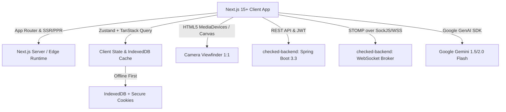
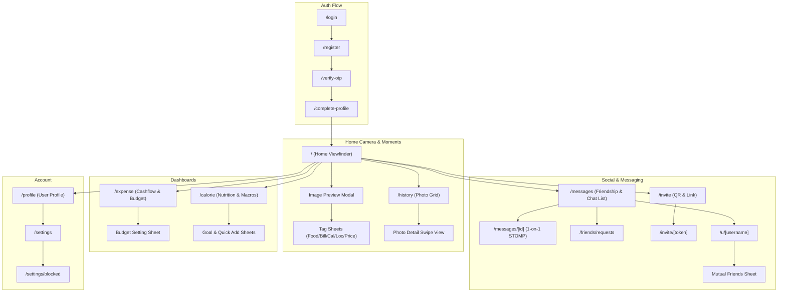
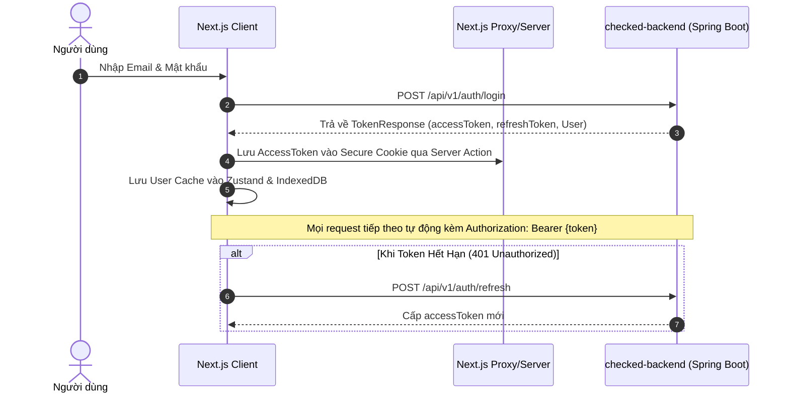
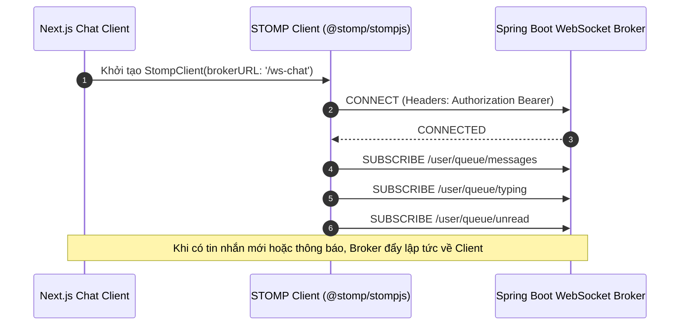

# 🚀 CHECKED NEXT.JS MIGRATION & IMPLEMENTATION MASTER PLAN
> **Dự án**: Checked Web Client (Next.js 15+ App Router)  
> **Nguồn đối chiếu**: `checked-ios` (SwiftUI Native) & `checked-backend` (Spring Boot, PostgreSQL, Garage S3, Redis, STOMP WebSocket)  
> **Thư mục đích**: `/Users/nguyenkimquockhanh/Desktop/checked-nextjs`  
> **Mục tiêu**: Tái hiện 100% giao diện Locket-style ấm áp ("Oat Milk & Matcha Glow"), chuyển đổi toàn bộ 23 màn hình/modal, giữ nguyên triệt để nghiệp vụ tính toán chi tiêu/calo, tích hợp Gemini AI Vision, và hệ thống chat thời gian thực STOMP.

---

## 📑 MỤC LỤC
1. [Tổng Quan & Chiến Lược Công Nghệ (Tech Stack)](#1-tổng-quan--chiến-lược-công-nghệ)
2. [Design System & Design Tokens Chuẩn (1:1 iOS)](#2-design-system--design-tokens-chuẩn)
3. [Danh Mục 23 Màn Hình & Trải Nghiệm Người Dùng (Full Screen Parity)](#3-danh-mục-23-màn-hình--trải-nghiệm-người-dùng)
4. [Kiến Trúc Tầng Logic & Dữ Liệu (Logic & Architecture)](#4-kiến-trúc-tầng-logic--dữ-liệu)
5. [Tích Hợp AI Gemini Vision & Sticker Cutout](#5-tích-hợp-ai-gemini-vision--sticker-cutout)
6. [Hệ Thống WebSocket STOMP Chat & Realtime Badges](#6-hệ-thống-websocket-stomp-chat--realtime-badges)
7. [Cấu Trúc Thư Mục Chuẩn Next.js App Router](#7-cấu-trúc-thư-mục-chuẩn-nextjs-app-router)
8. [Lộ Trình Triển Khai Chi Tiết Từng Giai Đoạn (Phased Roadmap)](#8-lộ-trình-triển-khai-chi-tiết-từng-giai-đoạn)
9. [Tiêu Chí Nghiệm Thu (Acceptance Criteria & Quality Gates)](#9-tiêu-chí-nghiệm-thu)

---

## 1. TỔNG QUAN & CHIẾN LƯỢC CÔNG NGHỆ

Checked Web là phiên bản Client UI chạy trên nền tảng Web & PWA dành cho điện thoại và máy tính, mang ngôn ngữ thiết kế tối giản, thân thiện, tương tác cảm ứng cao cấp tương tự ứng dụng iOS:



### 1.1 Tech Stack Lựa Chọn

| Thành phần | Công nghệ lựa chọn | Lý do & Vai trò đối chiếu |
| :--- | :--- | :--- |
| **Framework** | **Next.js 15+ (App Router, React 19, TypeScript)** | Kiến trúc RSC + Client Components mượt mà, tối ưu SEO, hỗ trợ Server Actions & Image Optimization. |
| **Styling** | **Tailwind CSS v4** | Định nghĩa toàn bộ Design Tokens qua CSS Variables `@theme`, hiệu năng CSS tĩnh cao, không runtime CSS overhead. |
| **UI Primitives** | **Radix UI & Shadcn UI** | Cung cấp các primitives unstyled chuẩn A11y (Dialog, Drawer/Sheet, Dropdown Menu, Slider, Tooltip). |
| **Icons** | **Lucide React** | Bộ icon SVG sạch, ánh xạ 1:1 với Apple SF Symbols (`fork.knife` $\rightarrow$ `Utensils`, `bolt.fill` $\rightarrow$ `Zap`,...). |
| **Motion & Gestures** | **Framer Motion** | Xử lý các tương tác: vuốt chuyển ảnh dọc (TikTok/Locket style), chạm co dãn (`active:scale-95`), bottom sheet trượt mở mượt mà. |
| **State & Cache** | **Zustand + TanStack Query v5 (React Query)** | Zustand quản lý trạng thái UI cục bộ (Camera, Audio, Filter Dropdown). TanStack Query cache dữ liệu API, optimistic update và sync ngầm. |
| **Realtime** | **`@stomp/stompjs` + `sockjs-client`** | Kết nối trực tiếp đến STOMP broker của `checked-backend` (`/ws-chat`), hỗ trợ kênh chat 1-1, unread badge, typing indicator. |
| **Camera & Media** | **WebRTC `MediaStream` + HTML5 Canvas** | Mở camera trực tiếp trên trình duyệt di động, cắt khung vuông chuẩn 1:1, hỗ trợ lật cam trước/sau và zoom quang học số. |
| **AI Vision** | **`@google/genai` (Gemini Flash)** | Phân tích trực tiếp ảnh hóa đơn (OCR & parse JSON) và nhận diện món ăn/calo theo đúng System Prompt chuẩn từ `checked-ios`. |
| **PWA Capability** | **Serwist / Next-PWA** | Chạy full-screen không thanh địa chỉ (`standalone`), hỗ trợ icon màn hình chính, camera permission caching, haptic feedback (`navigator.vibrate`). |

---

## 2. DESIGN SYSTEM & DESIGN TOKENS CHUẨN

Checked sở hữu bản sắc thị giác độc đáo: **Tông màu Oat Milk ấm áp kết hợp sắc Matcha Glow căng tràn sức sống**.

### 2.1 Color Tokens Palette

Toàn bộ mã màu từ `AppColors.swift` được chuyển hóa thành Design Tokens chuẩn:

```css
@theme {
  /* Canvas & Surface (Tonal Warmth) */
  --color-canvas: #EDE9DF;        /* Nền kem Oat Milk ấm rõ rệt */
  --color-surface: #FFFFFF;       /* Trắng tinh khiết */
  --color-surface-subtle: #DFDACD; /* Nền nút tròn Sand Dust */
  --color-gray-subtle: #F2F2F4;   /* Xám thanh lịch cho card phụ */

  /* Brand & Accents */
  --color-primary: #D4EB70;       /* Matcha Glow tươi sáng cho nút chụp & action chính */
  --color-primary-soft: #E6F5A3;  /* Matcha pastel cho pill badge */
  --color-accent: #BFDD4A;        /* Deep Matcha nhấn mạnh */
  --color-dark-surface: #141613;  /* Đen sâu cho khung camera viewfinder */

  /* Typography */
  --color-text-primary: #141613;  /* Chữ đen đậm rõ nét, độ tương phản cao */
  --color-text-secondary: #63685F;/* Chữ phụ, caption, nhãn phụ */

  /* Semantics */
  --color-error: #FF6954;         /* Đỏ san hô cảnh báo/vượt ngân sách */
  --color-success: #4E8752;       /* Xanh lá hoàn thành mục tiêu */
  --color-warning: #FF9500;       /* Cam cảnh báo ngưỡng chi tiêu */
}
```

### 2.2 Typography Hierarchy

Phối hợp font chữ rounded cho tiêu đề tạo cảm giác thân mật, và font geometric không chân cho nội dung đọc dễ dàng:
- **Font Display (Tiêu đề, Nút bấm)**: `Plus Jakarta Sans` hoặc `Nunito` (bo tròn thân thiện).
- **Font Body (Dữ liệu, số tiền, chat)**: `Inter` hoặc `Geist Sans` (sắc nét, tabular numbers).

| Token Name | Size / Line-Height | Weight | Font Family | Ứng dụng |
| :--- | :--- | :--- | :--- | :--- |
| `text-display` | `28px` / `34px` | Bold (700) | Rounded | Tiêu đề màn hình Dashboard, Lịch sử |
| `text-headline`| `20px` / `26px` | Semibold (600) | Rounded | Tiêu đề Card, Header Pop-up |
| `text-body-bold`| `16px` / `22px` | Semibold (600) | Sans | Tên người dùng, số tiền lớn, nút chính |
| `text-body` | `16px` / `22px` | Regular (400) | Sans | Tin nhắn chat, mô tả giao dịch |
| `text-caption` | `13px` / `18px` | Medium (500) | Sans | Thời gian, ghi chú dưới, nhãn tag |
| `text-button` | `16px` / `20px` | Bold (700) | Rounded | Chữ trong nút Primary & Action |

### 2.3 Component Dimension & Shape Tokens

- **Khung Camera & Preview Vuông**: Tỉ lệ cố định `1:1` (`aspect-square`), bo góc `rounded-[32px]`, viền chống tràn.
- **Nút Chụp Matcha Glow**: Kích thước `80x80px` (ngoài: vòng hào quang viền mờ `border-4 border-primary/40`, trong: nút tròn `70x70px` màu `#D4EB70`).
- **Nút Tròn Tiêu Chuẩn (Icon Button)**: `44x44px` hoặc `52x52px`, `rounded-full`, nền `#FFFFFF` hoặc `#DFDACD`, icon màu `#141613`.
- **Top Bar Pill Dropdown**: Chiều cao `38px`, `rounded-full`, nền `#FFFFFF`, hiển thị avatar thu nhỏ + tên bạn bè + mũi tên dropdown.
- **Card & Bottom Sheet**: Sheet trượt bo góc `rounded-t-[32px]`, Card danh sách bo `rounded-[24px]`.
- **Hiệu ứng Nhấn Chạm (Pressed Scale)**: `active:scale-95 transition-transform duration-150 ease-out`.

---

## 3. DANH MỤC 23 MÀN HÌNH & TRẢI NGHIỆM NGƯỜI DÙNG

Hệ thống Next.js sẽ tái hiện đầy đủ và chuẩn xác toàn bộ 23 view từ `checked-ios`:



### 3.1 Phân Hệ Xác Thực & Đăng Ký (Auth Flow)
1. **Đăng nhập (`/login`)**: Nhập email / password, tự động chuyển hướng OTP nếu tài khoản chưa kích hoạt, link sang đăng ký.
2. **Đăng ký (`/register`)**: Đăng ký thông tin tài khoản mới với email, password, username.
3. **Xác thực OTP (`/verify-otp`)**: 6 ô nhập mã số OTP tự động nhảy focus, đếm ngược thời gian gửi lại mã (Resend OTP).
4. **Hoàn thiện hồ sơ (`/complete-profile`)**: Tải avatar cá nhân vuông, nhập họ tên đầy đủ (`displayName`), cập nhật trạng thái `profileCompleted`.

### 3.2 Phân Hệ Camera & Bảng Tin Khoảnh Khắc (Home & Moments)
5. **Màn hình chính (`/`)**:
   - Khung camera 1:1 trực tiếp sử dụng WebRTC (`MediaStream`), nút đổi camera trước/sau, nút bật đèn trợ sáng flash/torch (nếu thiết bị hỗ trợ).
   - Nút zoom toggling trực tiếp `0.5x` $\leftrightarrow$ `1x` kèm gesture chụm ngón tay pinch-to-zoom.
   - Thanh Top Bar nổi gồm: Avatar cá nhân (mở Profile), nút Pill lọc theo bạn bè ("Tất cả", "Bạn", tên bạn bè), và nút Tin nhắn kèm Badge số tin chưa đọc.
   - Thẻ bạn bè xếp chồng 3D (`StackedFriendCardsView`): Chạm để mở nhanh khoảnh khắc mới nhất.
   - Nút Chụp Matcha Glow và nút mở thư viện ảnh (`<input type="file" accept="image/*">`).
6. **Xem trước & Gửi ảnh (Image Preview Overlay)**:
   - Ảnh chụp được crop vuông 1:1, chạy tự động module nhận diện Gemini AI Vision.
   - Card AI gợi ý thông minh với viền xoay màu thương hiệu Gemini và nút ghim các loại Tag.
   - Hiệu ứng bóc tách vật thể món ăn (Sticker cutout) và nút hiệu ứng tan biến Thanos Snap (vụn bụi hạt phân rã) kèm nút hoàn tác Time Stone.
   - 5 Sheet chỉnh sửa chi tiết:
     - `BillDetailSheet`: Tên quán, danh sách món, tiền thuế, tiền tip, tổng bill, chia tiền theo đầu người.
     - `FoodEditSheet`: Tên món ăn Việt Nam, nhóm món (Cơm, Phở, Bún, Trà sữa...), icon danh mục.
     - `CalorieEditSheet`: Số calo tùy chỉnh, các chỉ số đa lượng Protein, Carbs, Fat.
     - `PriceEditSheet`: Gắn thẻ giá tiền tự do dạng tiền tệ VNĐ.
     - `LocationEditSheet`: Gắn địa điểm quán ăn từ Geolocation HTML5 hoặc gõ tìm kiếm.
   - Lựa chọn đối tượng nhận ảnh: "Tất cả bạn bè", hoặc "Chỉ bạn thân".
7. **Lưới lịch sử khoảnh khắc (`/history`)**:
   - Lưới 3 cột chuẩn Locket, khoảng cách đều 6px, cuộn vô tận mượt mà.
   - Bộ lọc ảnh động theo người gửi ("Tất cả", "Chỉ mình tôi", "Từng bạn bè cụ thể").
   - Nhóm ảnh theo ngày kèm badge phân loại chi tiêu/món ăn.
8. **Xem chi tiết ảnh dọc (Photo Detail Swipe View)**:
   - Vuốt dọc kiểu TikTok / Locket để nhảy sang ảnh kế tiếp/trước đó.
   - Thả biểu tượng cảm xúc Emoji với engine hiệu ứng hạt Emoji nổ tung (`EmojiBurstEngine`).
   - Khung chat phản hồi nhanh trực tiếp đến người đăng ảnh.
   - Menu hành động: Lưu ảnh, xóa ảnh của tôi, báo cáo.

### 3.3 Phân Hệ Quản Lý Chi Tiêu & Tài Chính (Expense Module)
9. **Bảng điều khiển chi tiêu (`/expense`)**:
   - Bộ chọn tháng linh hoạt ($\leftarrow$ Tháng 10, 2026 $\rightarrow$).
   - Card dòng tiền tổng hợp (Tổng thu, Tổng chi, Dòng tiền ròng Net Cashflow).
   - Vòng tròn tiến độ ngân sách tháng (Budget Limit, Số tiền đã tiêu, Số tiền còn lại, cảnh báo đỏ khi vượt ngưỡng).
   - Biểu đồ phân bổ chi tiêu theo danh mục (Ăn uống, Mua sắm, Di chuyển...) với icon và tỷ lệ phần trăm.
   - Danh sách giao dịch chi tiêu theo ngày, chạm vào để phóng to hóa đơn gốc.
10. **Sheet cài đặt ngân sách (`BudgetSettingSheet`)**:
    - Nhập hạn mức ngân sách tháng.
    - Cài đặt ngưỡng phần trăm cảnh báo (ví dụ 80%).
    - Thiết lập mục tiêu tiết kiệm tích lũy.

### 3.4 Phân Hệ Dinh Dưỡng & Năng Lượng (Calorie Module)
11. **Bảng điều khiển Calo (`/calorie`)**:
    - Vòng tiến trình năng lượng ngày: Nạp vào vs Mục tiêu calo hàng ngày, số calo còn được phép nạp.
    - Thanh đo 3 dưỡng chất đa lượng: Protein (Đạm), Carbs (Đường bột), Fat (Chất béo).
    - Phân chia 4 bữa ăn trong ngày: Bữa sáng (05:00 - 10:30), Bữa trưa (10:30 - 14:30), Bữa phụ (14:30 - 17:00 & Đêm), Bữa tối (17:00 - 21:30).
    - Tự động nhận diện khung giờ hiện tại để đưa gợi ý bữa ăn chính xác.
12. **Sheet thiết lập mục tiêu calo (`CalorieGoalSettingSheet`)**:
    - Điều chỉnh mục tiêu Calo hàng ngày bằng thanh trượt hoặc nhập số.
13. **Sheet thêm nhanh món ăn (`QuickAddCalorieSheet`)**:
    - Thêm nhanh món ăn thủ công vào từng bữa ăn mà không cần chụp ảnh.

### 3.5 Phân Hệ Nhắn Tin Thời Gian Thực (Chat & Social)
14. **Danh sách bạn bè & Hội thoại (`/messages`)**:
    - Hàng thanh trạng thái giới hạn bạn thân (Quota Bar: ví dụ 12/20 bạn thân, huy hiệu Gold Member mở rộng quota).
    - Banner thông báo lời mời kết bạn đang chờ xét duyệt.
    - Danh sách hội thoại sắp xếp theo tin nhắn mới nhất, avatar bạn bè, badge tin nhắn chưa đọc.
15. **Phòng chat trực tiếp 1-1 (`/messages/[conversationId]`)**:
    - Kết nối STOMP WebSocket trực tiếp: Gửi/nhận tin nhắn tức thì.
    - Hiệu ứng người đối diện đang nhập (`isPartnerTyping`).
    - Trả lời tin nhắn dạng trích dẫn (Reply quote).
    - Thu hồi tin nhắn cho tất cả mọi người (`Revoke`) hoặc Xóa ở phía tôi (`Delete for me`).
    - Bong bóng gửi ảnh hóa đơn / khoảnh khắc kèm lời nhắn.

### 3.6 Phân Hệ Bạn Bè, Hồ Sơ & QR Code
16. **Mời bạn bè & Mã QR cá nhân (`/invite`)**:
    - Tạo mã QR cá nhân vector sắc nét.
    - Nút sao chép liên kết mời kết bạn (`https://checked.app/invite?token=...`).
    - Nút gọi Web Share API chia sẻ nhanh qua Messenger, Telegram, AirDrop...
17. **Chấp nhận lời mời kết bạn (`/invite/[token]`)**:
    - Trang Landing tiếp nhận link mời, hiển thị xem trước hồ sơ người mời.
    - Nút "Chấp nhận kết bạn" (tự động điều hướng sau khi đăng nhập nếu là khách).
18. **Quản lý lời mời kết bạn (`/friends/requests`)**:
    - Tab "Đã nhận": Đồng ý / Từ chối lời mời.
    - Tab "Đã gửi": Hủy lời mời đã gửi đi.
19. **Trang cá nhân người dùng (`/u/[username]`)**:
    - Thông tin cá nhân, avatar, trạng thái quan hệ (Bạn bè / Đã gửi lời mời / Chưa kết bạn / Bị chặn).
    - Nút xem danh sách bạn chung (`MutualFriendsSheet`).
    - Thư viện các khoảnh khắc công khai đã chia sẻ của người dùng đó.
20. **Trình quét mã QR (`/scan`)**: Quét mã QR bạn bè qua camera web để mở trực tiếp trang cá nhân hoặc chấp nhận kết bạn.
21. **Danh sách chặn (`/settings/blocked`)**: Quản lý và bỏ chặn người dùng.
22. **Trang cá nhân của tôi (`/profile`)**: Thống kê số lượng bạn bè, chuỗi ngày streak, tổng chi tiêu cá nhân, huy hiệu thành viên Gold.
23. **Cài đặt tài khoản (`/settings`)**: Cập nhật thông tin, đổi ảnh đại diện, cài đặt thông báo, đăng xuất.

---

## 4. KIẾN TRÚC TẦNG LOGIC & DỮ LIỆU

### 4.1 Quản Lý Token & Phiên Đăng Nhập An Toàn

Trên Next.js, kiến trúc bảo mật kết hợp giữa **HTTP-Only Cookies** cho Server Components/Proxy và **IndexedDB (hoặc LocalStorage an toàn)** cho Client SDK:



### 4.2 Lớp Dịch Vụ API Chuẩn Hóa (API Client & DTO Models)

Sử dụng Fetch API bọc kiểu Type-safe với đầy đủ xử lý query params, multipart uploads và tự động refresh token:

```typescript
// src/lib/api/client.ts
export interface RequestOptions extends RequestInit {
  params?: Record<string, string | number | boolean | undefined>;
}

export async function apiClient<T>(endpoint: string, options: RequestOptions = {}): Promise<T> {
  const token = getAccessToken(); // Lấy từ Cookie hoặc Zustand
  const headers = new Headers(options.headers || {});
  
  if (token) {
    headers.set('Authorization', `Bearer ${token}`);
  }
  
  if (!(options.body instanceof FormData)) {
    headers.set('Content-Type', 'application/json');
  }

  const url = buildUrl(endpoint, options.params);
  const response = await fetch(url, { ...options, headers });
  
  if (response.status === 401) {
    // Kích hoạt Silent Refresh Token
    return handleTokenRefreshAndRetry<T>(endpoint, options);
  }
  
  if (!response.ok) {
    const errorData = await response.json().catch(() => ({}));
    throw new ApiError(response.status, errorData.message || 'Lỗi kết nối máy chủ');
  }
  
  return response.json();
}
```

---

## 5. TÍCH HỢP AI GEMINI VISION & STICKER CUTOUT

Tái hiện chính xác module phân tích hóa đơn và món ăn của `checked-ios`:

### 5.1 Prompt Kỹ Thuật Gemini 1.5/2.0 Flash

Sử dụng đúng cấu trúc prompt từ `GeminiPromptBuilder.swift` để nhận diện hai loại hình ảnh chính:
1. **Chế độ Hóa đơn (Receipt Mode)**:
   - Trích xuất: Tên cửa hàng / thương hiệu, danh sách mặt hàng, thuế VAT, tiền boa, tổng số tiền thanh toán, phân loại danh mục chi tiêu.
   - Định dạng trả về: JSON có cấu trúc chuẩn (`BillData`).
2. **Chế độ Món ăn & Năng lượng (Food & Calorie Mode)**:
   - Trích xuất: Tên món ăn Việt Nam chuẩn vị (Phở bò, Cơm tấm sườn bì, Bún bò Huế, Trà sữa trân châu...), ước tính Calo (kcal), lượng đạm (Protein), đường bột (Carbs), chất béo (Fat), và nhóm thực phẩm.

### 5.2 Hiệu Ứng Bóc Tách Sticker & Tan Biến Thanos Snap

- **Bóc tách Sticker (Food Cutout)**:
  - Trên trình duyệt, sử dụng WebGL canvas hoặc thư viện `@imgly/background-removal` chạy trực tiếp ở client (WebAssembly) để tách nền món ăn, tạo đường viền trắng dày mô phỏng sticker iOS 18.
- **Thanos Snap Disintegration**:
  - Khi người dùng xóa món ăn, Canvas 2D sẽ chụp snapshot đối tượng món ăn, chia nhỏ thành lưới các điểm ảnh (particles), áp dụng lực gió và nhiễu loạn để phân tán hạt bụi đen/vàng mờ dần (`requestAnimationFrame`), mang lại trải nghiệm tương tác vui nhộn và độc đáo.

---

## 6. HỆ THỐNG WEBSOCKET STOMP CHAT & REALTIME BADGES

Checked sử dụng STOMP trên nền WebSocket kết nối trực tiếp đến Spring Boot:



- **Kênh lắng nghe**:
  - `/user/queue/messages`: Nhận tin nhắn mới tức thời, cập nhật vào danh sách chat không cần tải lại trang.
  - `/user/queue/typing`: Nhận tín hiệu đang gõ phím từ đối phương.
  - `/user/queue/unread`: Cập nhật huy hiệu số tin nhắn chưa đọc trên thanh Top Bar.

---

## 7. CẤU TRÚC THƯ MỤC CHUẨN NEXT.JS APP ROUTER

Cấu trúc dự án tại `/Users/nguyenkimquockhanh/Desktop/checked-nextjs`:

```text
checked-nextjs/
├── public/
│   ├── icons/                  # PWA icons & app icons
│   ├── sounds/                 # Âm thanh chụp camera, nút bấm
│   └── manifest.json           # Cấu hình PWA thoại di động
├── src/
│   ├── app/                    # Next.js 15 App Router Segments
│   │   ├── layout.tsx          # Root Layout (Theme Provider, Fonts, Top safe-area)
│   │   ├── page.tsx            # Trang Home (Camera Viewfinder & Feed)
│   │   ├── (auth)/
│   │   │   ├── login/page.tsx
│   │   │   ├── register/page.tsx
│   │   │   ├── verify-otp/page.tsx
│   │   │   └── complete-profile/page.tsx
│   │   ├── expense/page.tsx    # Dashboard Chi tiêu & Ngân sách
│   │   ├── calorie/page.tsx    # Dashboard Năng lượng & Calo
│   │   ├── history/page.tsx    # Lưới lịch sử khoảnh khắc
│   │   ├── messages/
│   │   │   ├── page.tsx        # Danh sách hội thoại & Bạn bè
│   │   │   └── [id]/page.tsx   # Phòng chat 1-1 thời gian thực
│   │   ├── invite/
│   │   │   ├── page.tsx        # Mã QR & Link mời bạn bè
│   │   │   └── [token]/page.tsx# Tiếp nhận link mời kết bạn
│   │   ├── friends/
│   │   │   └── requests/page.tsx # Lời mời kết bạn đã nhận/gửi
│   │   ├── u/[username]/page.tsx # Hồ sơ cá nhân của người dùng khác
│   │   ├── profile/page.tsx    # Hồ sơ của tôi
│   │   ├── settings/
│   │   │   ├── page.tsx        # Cài đặt ứng dụng
│   │   │   └── blocked/page.tsx# Danh sách người dùng bị chặn
│   │   └── scan/page.tsx       # Quét mã QR bằng Camera
│   ├── components/
│   │   ├── common/             # Button, Avatar, Input, Skeleton Bone
│   │   ├── layout/             # HomeTopBar, HeaderBar, BottomSheet
│   │   ├── camera/             # CameraViewfinder, CaptureButton, Controls
│   │   ├── preview/            # ImagePreview, TagPills, ThanosSnapCanvas
│   │   ├── expense/            # CashflowCard, BudgetRing, ExpenseList
│   │   ├── calorie/            # CalorieRing, MacroBar, MealCard
│   │   ├── chat/               # ChatBubble, ChatInput, TypingIndicator
│   │   └── social/             # FriendCard, QrCodeCard, QuotaBar
│   ├── hooks/                  # Custom Hooks (useCamera, useStompChat, useGeolocation)
│   ├── lib/
│   │   ├── api/                # API client, Endpoints, Fetch wrappers
│   │   ├── ai/                 # Gemini Prompt Builder, Vision Coordinator
│   │   ├── websocket/          # StompWebSocketClient
│   │   └── utils/              # Định dạng tiền tệ, ngày giờ, crop ảnh
│   ├── stores/                 # Zustand Stores (auth, camera, ui, chat)
│   └── types/                  # TypeScript Types & DTOs ánh xạ từ iOS & Backend
├── tailwind.config.ts          # Cấu hình Design Tokens & Colors
├── next.config.ts              # Cấu hình PWA & Image Remote Patterns
└── package.json
```

---

## 8. LỘ TRÌNH TRIỂN KHAI CHI TIẾT TỪNG GIAI ĐOẠN

Kế hoạch được chia thành 10 giai đoạn tuần tự, có thể kiểm thử độc lập:

### Giai Đoạn 1: Khởi Tạo Dự Án, Design Tokens & Cấu Trúc Khung
- **Nhiệm vụ**:
  1. Khởi tạo Next.js 15+ TypeScript tại thư mục `/Users/nguyenkimquockhanh/Desktop/checked-nextjs`.
  2. Cài đặt các gói phụ thuộc cốt lõi: `tailwindcss`, `lucide-react`, `framer-motion`, `zustand`, `@tanstack/react-query`, `@stomp/stompjs`, `sockjs-client`, `clsx`, `tailwind-merge`.
  3. Định nghĩa toàn bộ hệ thống màu sắc (`AppColors`), kích thước, bo góc, font chữ (`Plus Jakarta Sans` & `Inter`) trong CSS và Tailwind Theme.
  4. Tạo các UI Components dùng chung: `PrimaryButton`, `CircleIconButton`, `CustomTextField`, `SkeletonBone`, `HomeTopBar`, `BaseBottomSheet`.
- **Kiểm tra**: Chạy `npm run dev`, trang trắng hiển thị đúng màu nền Canvas Oat Milk (`#EDE9DF`) và Typography chuẩn.

### Giai Đoạn 2: Phân Hệ Xác Thực & Quản Lý Phiên Làm Việc (Auth Flow)
- **Nhiệm vụ**:
  1. Triển khai `authStore` (Zustand) và cơ chế lưu trữ JWT token qua cookie và local storage.
  2. Xây dựng 4 màn hình: Login, Register, OTP Verify (6 ô nhập tự nhảy focus), Complete Profile (upload avatar).
  3. Xây dựng Middleware / Route Guard: Tự động chuyển hướng về `/login` nếu chưa đăng nhập, hoặc vào `/complete-profile` nếu hồ sơ chưa xong.
- **Kiểm tra**: Đăng ký tài khoản mới $\rightarrow$ Nhập OTP $\rightarrow$ Cập nhật tên và avatar $\rightarrow$ Chuyển thẳng vào HomeView.

### Giai Đoạn 3: Camera Trình Duyệt 1:1 & Trải Nghiệm Màn Hình Chính
- **Nhiệm vụ**:
  1. Tạo `CameraViewfinder.tsx` dùng `navigator.mediaDevices.getUserMedia`:
     - Hiển thị video stream chuẩn khung vuông 1:1 bo góc `32px`.
     - Nút lật camera trước/sau (`facingMode: user / environment`).
     - Nút chuyển zoom nhanh `0.5x` $\leftrightarrow$ `1x`.
     - Nút bật flash/torch (nếu trình duyệt điện thoại hỗ trợ).
  2. Nút chụp ảnh Matcha Glow: Chụp frame hiện tại từ HTML5 `<video>`, vẽ lên `<canvas>` và xuất file ảnh vuông chuẩn 1080x1080.
  3. Input chọn ảnh từ album thiết bị kèm tự động cắt vuông (`cropToSquare`).
  4. Thanh Top Bar tương tác kèm Menu Pill Dropdown chuyển đổi lọc ảnh giữa Bạn bè và Tất cả.
- **Kiểm tra**: Mở camera trên Safari iOS / Chrome Android, chạm nút Matcha Glow chụp được ảnh vuông sắc nét.

### Giai Đoạn 4: Tích Hợp AI Gemini Vision, Tag System & Hiệu Ứng Sticker
- **Nhiệm vụ**:
  1. Xây dựng `ImagePreviewView.tsx` nhận ảnh vừa chụp, hiển thị thanh Gemini Brand Pill chuyển động xoay màu gradient.
  2. Tích hợp Google Gemini Flash API: Nhận diện hóa đơn tính tiền hoặc món ăn Việt Nam + Calo / Macros.
  3. Xây dựng 5 Sheet chỉnh sửa: `BillDetailSheet`, `FoodEditSheet`, `CalorieEditSheet`, `PriceEditSheet`, `LocationEditSheet`.
  4. Hiệu ứng Sticker cutout bóc tách món ăn và hiệu ứng Thanos Snap làm bụi phân rã món ăn.
  5. Gọi API `POST /api/v1/photos` (Multipart) tải ảnh kèm metadata chi tiêu lên Backend.
- **Kiểm tra**: Chụp hóa đơn cà phê $\rightarrow$ Gemini tự động bóc tách số tiền và tên quán $\rightarrow$ Bấm Gửi $\rightarrow$ Ảnh xuất hiện trong Feed.

### Giai Đoạn 5: Lưới Lịch Sử Khoảnh Khắc & Trình Xem Ảnh Vuốt Dọc
- **Nhiệm vụ**:
  1. Xây dựng `HistoryPhotoGridView.tsx`: Lưới ảnh 3 cột đều nhau, cuộn vô tận, lọc theo người gửi ("Tất cả", "Bạn", từng bạn bè).
  2. Xây dựng `PhotoDetailView.tsx`:
     - Vuốt dọc để chuyển đổi qua lại giữa các khoảnh khắc.
     - Hiển thị thông tin người gửi, thời gian, vị trí, thẻ giá tiền/calo.
     - Thanh biểu tượng cảm xúc Emoji kèm engine hiệu ứng hạt Emoji bùng nổ (`EmojiBurstEngine`).
     - Tích hợp gọi API Reactions: Thả tim, haha, wow...
- **Kiểm tra**: Vuốt mượt mà trên màn hình cảm ứng, chạm emoji thấy các icon bay lượn và tăng số lượng phản hồi.

### Giai Đoạn 6: Bảng Điều Khiển Chi Tiêu & Dòng Tiền (Expense Module)
- **Nhiệm vụ**:
  1. Xây dựng `ExpenseDashboardView.tsx`:
     - Bộ chuyển tháng trước / sau.
     - Thẻ tổng hợp dòng tiền (Thu, Chi, Net Cashflow).
     - Vòng tròn tiến độ ngân sách và cảnh báo vượt hạn mức.
     - Biểu đồ phân bổ tỷ lệ phần trăm theo danh mục.
     - Lịch sử danh sách giao dịch, chạm để xem hóa đơn gốc.
  2. Xây dựng `BudgetSettingSheet.tsx`: Cập nhật hạn mức chi tiêu tháng và mục tiêu tiết kiệm.
- **Kiểm tra**: Số tiền chi tiêu cập nhật tự động ngay khi có ảnh hóa đơn mới được gửi lên.

### Giai Đoạn 7: Bảng Điều Khiển Năng Lượng & Dinh Dưỡng (Calorie Module)
- **Nhiệm vụ**:
  1. Xây dựng `CalorieDashboardView.tsx`:
     - Vòng tròn đo mức năng lượng nạp vào so với mục tiêu ngày.
     - Thanh tiến độ dinh dưỡng đa lượng Protein, Carbs, Fat.
     - Phân loại 4 bữa ăn (Sáng, Trưa, Tối, Phụ) tự động highlight bữa ăn theo thời gian thực.
  2. Xây dựng `CalorieGoalSettingSheet.tsx` và `QuickAddCalorieSheet.tsx`.
- **Kiểm tra**: Đồng bộ calo từ các ảnh món ăn đã chụp trong ngày, thêm nhanh món ăn thủ công thành công.

### Giai Đoạn 8: Nhắn Tin Thời Gian Thực STOMP WebSocket
- **Nhiệm vụ**:
  1. Cấu hình kết nối STOMP Client qua SockJS đến endpoint `/ws-chat`.
  2. Xây dựng `FriendshipListView.tsx`: Danh sách bạn bè kết hợp hội thoại chat, huy hiệu số tin chưa đọc.
  3. Xây dựng `ChatView.tsx`:
     - Bong bóng tin nhắn (gửi/nhận, trạng thái đã đọc, ảnh đính kèm).
     - Phản hồi trích dẫn (Reply quote).
     - Thu hồi tin nhắn (`Revoke`) và Xóa phía tôi.
     - Hiển thị hiệu ứng `isPartnerTyping` khi đối phương đang soạn thảo.
- **Kiểm tra**: Mở 2 cửa sổ trình duyệt chat qua lại, tin nhắn và chỉ báo đang nhập hiển thị tức thì không có độ trễ.

### Giai Đoạn 9: Đồ Thị Xã Hội, Lời Mời Kết Bạn, QR Code & Deep Links
- **Nhiệm vụ**:
  1. Xây dựng `FriendInviteView.tsx`: Sinh mã QR cá nhân, nút sao chép link mời kết bạn và chia sẻ qua Web Share API.
  2. Xây dựng `FriendInviteAcceptView.tsx`: Xử lý URL deep link `https://checked.app/invite?token=...` để kết bạn tức thì.
  3. Xây dựng `FriendRequestsView.tsx`: Quản lý yêu cầu kết bạn đến và đi.
  4. Xây dựng `UserProfileView.tsx` và `MutualFriendsSheet.tsx`: Xem trang cá nhân người khác, danh sách bạn chung.
  5. Xây dựng `QrScannerView.tsx`: Quét mã QR bạn bè trực tiếp qua camera.
- **Kiểm tra**: Quét mã QR hoặc click link mời từ bên ngoài $\rightarrow$ Ứng dụng tự động mở popup xác nhận kết bạn thành công.

### Giai Đoạn 10: Tối Ưu PWA, Cảm Ứng Di Động & Đảm Bảo Chất Lượng
- **Nhiệm vụ**:
  1. Cấu hình Manifest PWA, service worker cache tĩnh, hỗ trợ Add to Home Screen với giao diện Fullscreen Standalone.
  2. Khóa phóng to ngoài ý muốn (`user-scalable=no, viewport-fit=cover`), căn chỉnh an toàn theo `env(safe-area-inset-top)` và `env(safe-area-inset-bottom)`.
  3. Tích hợp rung phản hồi haptic (`navigator.vibrate`) khi bấm nút chụp và các nút chính.
  4. Kiểm thử toàn diện (Cross-browser trên iOS Safari, iPadOS, Android Chrome, Desktop macOS).
- **Kiểm tra**: Ứng dụng hoạt động mượt mà như một native app khi cài đặt lên Home Screen điện thoại.

---

## 9. TIÊU CHÍ NGHIỆM THU (ACCEPTANCE CRITERIA)

| Hạng mục | Tiêu chuẩn bắt buộc |
| :--- | :--- |
| **Giao diện & Token** | Đúng 100% mã màu (`#EDE9DF`, `#D4EB70`, `#141613`), bo góc `32px` khung camera, typography rounded cho tiêu đề. |
| **Khung Camera** | Tỉ lệ vuông `1:1`, không giật lag, chụp và crop ảnh chính xác, có hỗ trợ lật cam và zoom. |
| **Nhận diện AI** | Tích hợp thành công Gemini Flash, tự động bóc tách hóa đơn ra số tiền/tên quán và món ăn ra calo. |
| **Số lượng màn hình** | Đủ 23 màn hình và sheet, điều hướng mượt mà không vỡ layout khi chuyển trang. |
| **Thời gian thực** | Chat WebSocket STOMP nhận tin tức thời $< 200ms$, badge tin nhắn chưa đọc cập nhật tự động. |
| **Tài chính & Calo** | Dữ liệu chi tiêu và calo tính toán chính xác, tự động nhảy số theo dữ liệu backend hoặc offline cache. |
| **PWA & Mobile Web** | Trải nghiệm vuốt chạm không khựng, hỗ trợ standalone mode không bị thanh URL che lấp. |

