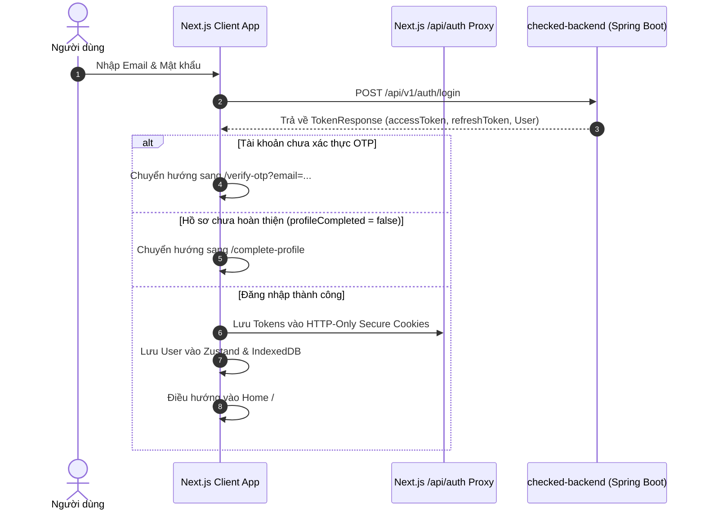

# 🔐 AUTHENTICATION & SECURITY SPECIFICATION

Tài liệu này xác định cơ chế xác thực JWT, bảo vệ tuyến đường (Route Guarding), xử lý làm mới phiên tự động (Silent Token Refresh), và lưu trữ an toàn trên môi trường Web.

---

## 1. QUY TRÌNH XÁC THỰC VÀ ĐĂNG NHẬP

Checked sử dụng cơ chế bảo mật kết hợp Access Token thời hạn ngắn và Refresh Token thời hạn dài:



---

## 2. QUẢN LÝ LƯU TRỮ TOKEN (TOKEN STORAGE MATRIX)

Để ngăn ngừa lỗ hổng XSS (Cross-Site Scripting) và CSRF (Cross-Site Request Forgery):

| Loại Token | Nơi lưu trữ | Thuộc tính bảo mật | Mục đích sử dụng |
| :--- | :--- | :--- | :--- |
| **`refresh_token`** | **HTTP-Only Cookie** | `HttpOnly; Secure; SameSite=Strict; Path=/api/auth` | Chỉ được gửi tự động khi gọi route làm mới token, JavaScript ở client hoàn toàn không thể đọc. |
| **`access_token`** | **In-Memory (Zustand)** | Bộ nhớ RAM của ứng dụng | Dùng đính kèm vào Header `Authorization: Bearer <token>` cho mọi request REST và WebSocket STOMP. |
| **`user_profile`** | **IndexedDB** | Plain Object có mã hóa nhẹ | Hiển thị tức thì thông tin người dùng khi vừa mở app mà không cần chờ mạng. |

---

## 3. CƠ CHẾ LÀM MỚI TOKEN TỰ ĐỘNG (SILENT REFRESH INTERCEPTOR)

Khi một request API nhận mã lỗi `401 Unauthorized`:

```typescript
let isRefreshing = false;
let failedQueue: Array<{ resolve: (token: string) => void; reject: (err: any) => void }> = [];

export async function handleSilentRefresh(): Promise<string> {
  if (isRefreshing) {
    return new Promise((resolve, reject) => {
      failedQueue.push({ resolve, reject });
    });
  }

  isRefreshing = true;

  try {
    const response = await fetch('/api/auth/refresh', { method: 'POST' });
    if (!response.ok) throw new Error('Refresh token invalid');
    
    const data = await response.json();
    const newAccessToken = data.accessToken;
    
    // Cập nhật RAM store
    useAuthStore.getState().setAccessToken(newAccessToken);
    
    failedQueue.forEach(prom => prom.resolve(newAccessToken));
    failedQueue = [];
    return newAccessToken;
  } catch (err) {
    failedQueue.forEach(prom => prom.reject(err));
    failedQueue = [];
    useAuthStore.getState().logout();
    window.location.href = '/login';
    throw err;
  } finally {
    isRefreshing = false;
  }
}
```

---

## 4. BẢO VỆ TUYẾN ĐƯỜNG (MIDDLEWARE & ROUTE GUARDS)

Sử dụng `src/proxy.ts` (Next.js 16) hoặc `middleware.ts` để kiểm tra phân quyền:
- **Tuyến đường công khai (Public Routes)**: `/login`, `/register`, `/verify-otp`, `/invite/[token]`.
- **Tuyến đường yêu cầu đăng nhập (Protected Routes)**: `/`, `/expense`, `/calorie`, `/messages`, `/profile`, `/settings`.
- **Logic xử lý**:
  - Nếu truy cập trang Protected mà chưa có session $\rightarrow$ Chuyển hướng về `/login?redirect=<target_url>`.
  - Nếu đã đăng nhập nhưng `profileCompleted === false` mà cố truy cập `/` $\rightarrow$ Ép chuyển hướng sang `/complete-profile`.
  - Nếu đã đăng nhập mà cố vào `/login` hoặc `/register` $\rightarrow$ Chuyển hướng về `/`.

