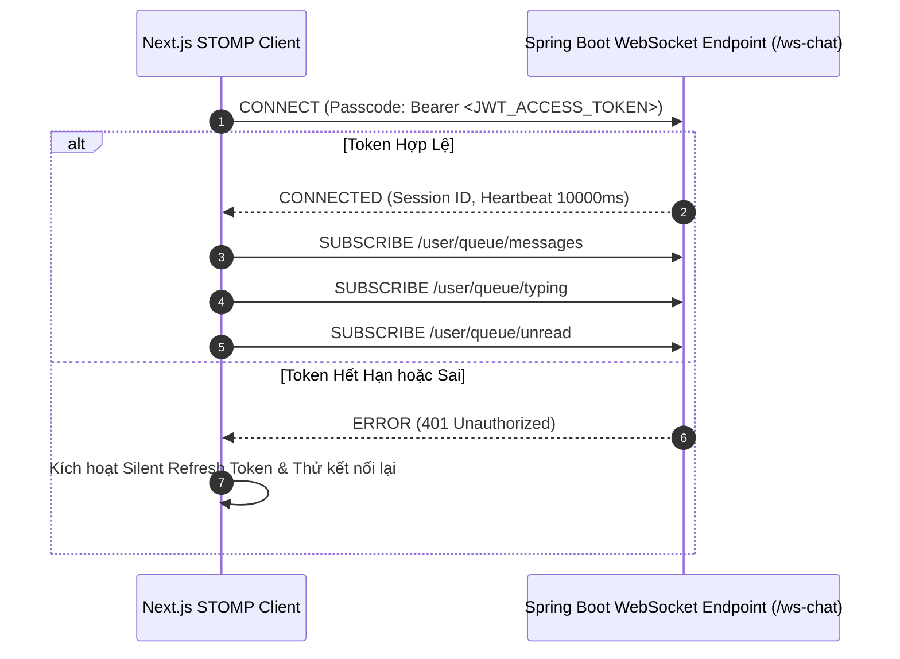

# ⚡ REALTIME WEBSOCKET & STOMP CHAT SPECIFICATION

Checked sử dụng giao thức **STOMP (Simple Text Oriented Messaging Protocol)** chạy trên nền WebSocket và fallback SockJS, kết nối trực tiếp đến Message Broker tích hợp trong Spring Boot 3.3.

---

## 1. CẤU TRÚC KẾT NỐI VÀ CHU TRÌNH SỐNG (CONNECTION LIFECYCLE)

---

## 2. ĐẶC TẢ CÁC KÊNH TRAO ĐỔI DỮ LIỆU (CHANNELS)

### 2.1 Kênh Nhận Dữ Liệu Từ Máy Chủ (Subscriptions)

| Destination | Định dạng Payload | Mục đích |
| :--- | :--- | :--- |
| `/user/queue/messages` | `ChatMessageResponse` | Nhận tin nhắn mới (văn bản, ảnh, trích dẫn) được gửi đến tôi. |
| `/user/queue/typing` | `{ conversationId: string, isTyping: boolean, username: string }` | Nhận trạng thái "Người đối diện đang gõ...". |
| `/user/queue/unread` | `{ totalUnreadCount: number }` | Nhận số lượng tin nhắn chưa đọc cập nhật cho Top Bar badge. |
| `/user/queue/messages/revoked` | `{ messageId: string, conversationId: string }` | Nhận sự kiện thu hồi tin nhắn cho tất cả mọi người. |

### 2.2 Kênh Gửi Dữ Liệu Lên Máy Chủ (Publishing)

| Destination | Định dạng Payload | Mục đích |
| :--- | :--- | :--- |
| `/app/chat.send` | `{ recipientId: string, content: string, replyToMessageId?: string, photoId?: string }` | Gửi tin nhắn mới đến bạn bè. |
| `/app/chat.typing` | `{ conversationId: string, isTyping: boolean }` | Báo hiệu tôi đang nhập hoặc dừng nhập. |
| `/app/chat.read` | `{ conversationId: string }` | Đánh dấu tôi đã xem hết tin nhắn trong phòng chat. |
| `/app/chat.revoke` | `{ messageId: string }` | Thu hồi tin nhắn đã gửi. |

---

## 3. CHIẾN LƯỢC TỰ ĐỘNG KẾT NỐI LẠI (AUTO-RECONNECT & RESILIENCE)

- **Exponential Backoff**: Khi mất kết nối (do mạng chập chờn hoặc chuyển tab):
  - Lần 1: Thử lại sau $1000ms$.
  - Lần 2: Thử lại sau $2000ms$.
  - Lần 3: Thử lại sau $4000ms$ (tối đa $10000ms$).
- **Lắng nghe sự kiện Online/Offline của Trình duyệt**:
  - `window.addEventListener('online', reconnect)`: Kích hoạt kết nối lại ngay khi thiết bị có mạng.
  - `document.addEventListener('visibilitychange')`: Khi người dùng mở lại tab trình duyệt, tự động kiểm tra heartbeat và tái kết nối nếu socket đã bị ngắt ngầm.

