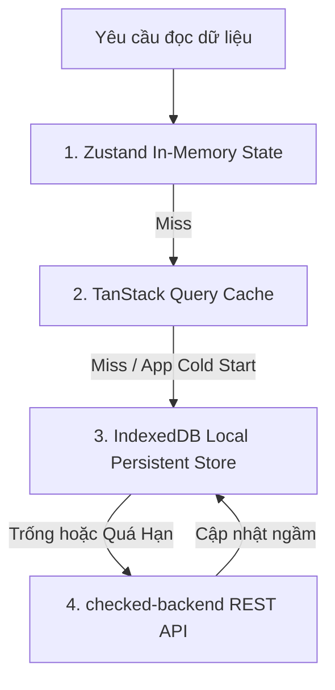

# 🏗️ SYSTEM ARCHITECTURE SPECIFICATION

Tài liệu này xác định kiến trúc tổng thể của Checked Web Client trên nền tảng Next.js 15+ App Router, đảm bảo hiệu năng tải trang cao, tính tương thích đa nền tảng và hỗ trợ PWA offline-first.

---

## 1. MÔ HÌNH PHÂN TÁCH SERVER & CLIENT COMPONENTS

Next.js 15 App Router cho phép kết hợp tối ưu giữa **React Server Components (RSC)** và **Client Components ('use client')**:

```text
┌────────────────────────────────────────────────────────┐
│  RootLayout (RSC: Metadata, Viewport, Theme Injection)  │
│  └──────────────────────────────────────────────────┐  │
│    │ Providers (QueryClient, AuthProvider, Toaster) │  │
│    └────────────────────────────────────────────────┘  │
│      ├── / (Home Viewfinder - Client Component)        │
│      │   ├── WebRTC Video Stream                       │
│      │   ├── Canvas Snapshot Crop 1:1                  │
│      │   └── Floating TopBar & Dropdown                │
│      ├── /expense (Dashboard - Hybrid RSC + CSR)       │
│      │   ├── Server: Pre-fetch tháng hiện tại          │
│      │   └── Client: Tương tác chuyển tháng, biểu đồ   │
│      ├── /calorie (Dashboard - Hybrid RSC + CSR)       │
│      └── /messages/[id] (Chat - Client Component)      │
│          └── WebSocket STOMP Connection                │
└────────────────────────────────────────────────────────┘
```

### 1.1 Nguyên Tắc Phân Chia
- **Server Components (Mặc định)**: Dùng cho trang hiển thị tĩnh hoặc trang cần pre-render dữ liệu cho SEO/Deep-link (ví dụ `/invite/[token]`, `/u/[username]`).
- **Client Components (`'use client'`)**: Bắt buộc cho các phân hệ cần quyền truy cập API thiết bị trình duyệt:
  - `CameraViewfinder`: Cần `navigator.mediaDevices`.
  - `ChatView`: Cần kết nối WebSocket liên tục.
  - `ImagePreviewView`: Cần xử lý Canvas 2D/WebGL tách sticker.
  - Các Bottom Sheet và Floating Dropdown có animation tương tác.

---

## 2. KIẾN TRÚC PWA & GIAO DIỆN DI ĐỘNG CHUẨN NATIVE

Để loại bỏ hoàn toàn cảm giác "đang duyệt web", ứng dụng cấu hình các thẻ meta và manifest chuyên dụng:

### 2.1 Viewport & Safe Area
```html
<meta name="viewport" content="width=device-width, initial-scale=1, maximum-scale=1, user-scalable=no, viewport-fit=cover" />
<meta name="apple-mobile-web-app-capable" content="yes" />
<meta name="apple-mobile-web-app-status-bar-style" content="black-translucent" />
<meta name="theme-color" content="#EDE9DF" />
```

- **Chống nảy trang (Overscroll Behavior)**: `overscroll-behavior-y: none;` trên phần tử body để tránh hiện tượng kéo nảy cả trang trên Safari iOS.
- **Xử lý Dynamic Island / Tai thỏ**: Sử dụng biến môi trường CSS `env(safe-area-inset-top)` và `env(safe-area-inset-bottom)` cho tất cả các TopBar và Bottom Controls.

---

## 3. CHIẾN LƯỢC CACHING VÀ OFFLINE-FIRST

Hệ sinh thái Checked lưu trữ dữ liệu theo mô hình 3 lớp phân cấp:



1. **Lớp 1: In-Memory (Zustand)**: Lưu trạng thái phiên đăng nhập, bộ lọc đang chọn, ảnh vừa chụp trong RAM để phản hồi trong $0ms$.
2. **Lớp 2: TanStack Query v5 Cache**: Lưu trữ danh sách bài đăng feed, giao dịch chi tiêu, lịch sử tin nhắn với chiến lược `stale-while-revalidate`.
3. **Lớp 3: IndexedDB Store (`idb-keyval`)**: Lưu trữ offline danh sách bạn bè, thông tin hồ sơ `User`, và ảnh tạm khi mất mạng, đảm bảo khi mở ứng dụng ở chế độ máy bay vẫn hiển thị đầy đủ giao diện.

