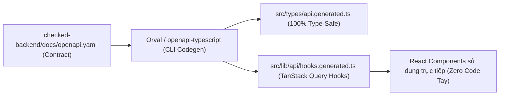

# 📱 BỘ THƯ VIỆN CÔNG NGHỆ CHUẨN IPHONE & TỐI ƯU HÓA CODE (TECH STACK & CODEGEN)

> **Mục tiêu**:  
> 1. Mang lại cảm giác chạm lướt, vật lý và độ hoàn thiện thị giác **giống hệt iPhone (iOS Native Feel)** mà không dùng blur/shadow.  
> 2. Tự động sinh mã nguồn API (**API Code Generation**), giảm thiểu tối đa code thủ công (Boilerplate-free).  
> 3. Tăng tốc độ phát triển (Fast Development), quản lý state và form tinh gọn, đạt chuẩn S.O.L.I.D.

---

## 1. HỆ SINH THÁI THƯ VIỆN GIAO DIỆN & TRẢI NGHIỆM CHUẨN IPHONE (IOS NATIVE FEEL)

Để Web App hoạt động trên Safari iOS và PWA mượt mà, chân thực như một ứng dụng iOS viết bằng SwiftUI:

| Thư viện | Vai trò | Tại sao chọn? (Đặc tính chuẩn iOS) |
| :--- | :--- | :--- |
| **`vaul`** *(by Emil Kowalski)* | **iOS Bottom Drawer / Sheet** | **Chuẩn mực vàng của iOS Drawer**. Hỗ trợ vuốt kéo có lực hãm quán tính (rubber-band drag physics), snap points, đóng bằng cử chỉ vuốt xuống tốc độ cao, tương thích hoàn hảo với bàn phím ảo iOS. |
| **`sonner`** *(by Emil Kowalski)* | **iOS Toast Notification** | Toast xếp chồng chuẩn Apple, chuyển động mượt mà bằng spring physics, vuốt ngang để xóa thông báo, không giật lag. |
| **`@number-flow/react`** | **Animated Numbers (Số lật iOS)** | Khi số tiền chi tiêu hoặc calo thay đổi, các con số sẽ cuộn lật êm ái giống giao diện Apple Pay, ứng dụng Stocks và Đồng hồ của iOS. |
| **`framer-motion`** | **Spring Gestures & Transitions** | Xử lý các tương tác chạm co nảy `active:scale-95`, vuốt dọc chuyển ảnh (snap scroll), thẻ bài 3D xếp chồng và hiệu ứng lò xo cơ học. |
| **Lucide React** | **Iconography Ánh Xạ SF Symbols** | Bộ vector icon sạch, nét vẽ mảnh chuẩn Apple, ánh xạ 1:1 với các biểu tượng Apple SF Symbols (`Receipt`, `Utensils`, `Flame`, `MapPin`, `RotateCcw`, `Camera`). |
| **Haptic Web Audio Engine** | **Phản Hồi Xúc Giác Đa Nền Tảng** | Kết hợp `navigator.vibrate(25)` trên Android và sinh âm thanh click cơ học cực nhẹ ($20ms$, tần số cao $1800Hz$) trên iOS Safari qua Web Audio API để tạo cảm giác rung phím camera thật. |

### 1.1 Cấu Hình Font Chữ Chuẩn iPhone (Apple Typography Stack)
Sử dụng trực tiếp các font chữ hệ thống của Apple trên thiết bị:
```css
/* Display & Headlines (Bo tròn thân thiện) */
font-family: -apple-system, BlinkMacSystemFont, "SF Pro Rounded", "Plus Jakarta Sans", sans-serif;

/* Body, Data & Numbers (Sắc nét) */
font-family: -apple-system, BlinkMacSystemFont, "SF Pro Text", "Inter", sans-serif;
```

---

## 2. BỘ CÔNG CỤ SINH API TỰ ĐỘNG & DATA FETCHING (ZERO BOILERPLATE API)

Thay vì phải tự viết hàng trăm hàm `fetch`, định nghĩa thủ công các interface DTO dễ gây sai sót, dự án tích hợp pipeline sinh API tự động từ tài liệu [openapi.yaml](file:///Users/nguyenkimquockhanh/Desktop/checked-backend/docs/openapi.yaml) (43KB) của `checked-backend`:



### 2.1 Thư Viện Sinh Code API Được Chọn

| Thư viện | Chức năng | Lợi ích giảm code |
| :--- | :--- | :--- |
| **`orval`** | **OpenAPI $\rightarrow$ TanStack Query Hooks** | **Tự động sinh 100%** các hook: `useGetExpensesSummary()`, `usePostPhotos()`, `useGetFriendsList()` kèm sẵn Query Keys, Loading, Error, và Types. Giảm hơn $70\%$ code API thủ công! |
| **`openapi-fetch`** | **Type-safe Fetch Client ($< 6KB$)** | Bộ fetch bọc kiểu siêu nhẹ, tự động autocomplete đường dẫn `/api/v1/expenses/summary`, query params, và body mà không sinh code thừa. |
| **`@tanstack/react-query` v5** | **Server State & Cache** | Quản lý cache dữ liệu máy chủ, tự động revalidate khi đổi tab, đồng bộ dữ liệu ngầm và hỗ trợ Optimistic Updates khi gửi tin nhắn/thả tim. |

---

## 3. QUẢN LÝ TRẠNG THÁI & BIỂU MẪU CỰC NHẸ (STATE & FORM MANAGEMENT)

| Thư viện | Vai trò | Lợi ích |
| :--- | :--- | :--- |
| **`zustand`** | **Client State Management ($1KB$)** | Quản lý Camera stream, Auth token trong RAM, UI Bottom Sheets, Filter bạn bè. Cú pháp cực ngắn, không boilerplate. |
| **`zustand/middleware (persist)`** + **`idb-keyval`** | **Offline IndexedDB Storage** | Tự động đồng bộ state người dùng, danh sách bạn bè vào IndexedDB để mở app chế độ máy bay vẫn xem được khoảnh khắc. |
| **`immer`** | **Immutable State Mutation** | Cho phép mutate state trực tiếp sạch sẽ (`state.isFlashOn = !state.isFlashOn`) mà không cần `...spread` phức tạp. |
| **`react-hook-form`** | **Form Management Hiệu Năng Cao** | Quản lý form bằng uncontrolled inputs, không gây re-render cả trang, tối ưu tuyệt đối cho bàn phím ảo di động. |
| **`zod`** + **`@hookform/resolvers`** | **Schema Validation 1 Dòng** | Khai báo luật validate (email hợp lệ, mật khẩu $\ge 8$ ký tự, số tiền $> 0$) chỉ trong 1 schema Zod duy nhất. |

---

## 4. CAMERA, QR SCANNER & XỬ LÝ ĐỒ HỌA TRÌNH DUYỆT

| Thư viện | Vai trò | Mô tả |
| :--- | :--- | :--- |
| **`html5-qrcode`** | **Camera QR Code Scanner** | Thư viện quét mã QR qua camera trình duyệt nhỏ gọn, nhận diện nhanh $< 100ms$ trên luồng video WebRTC. |
| **`qrcode.react`** | **Vector QR Generator** | Tạo mã QR cá nhân dưới dạng SVG vector sắc nét trên màn hình Retina của iPhone. |
| **`browser-image-compression`** | **Nén ảnh Client trước khi Upload** | Tự động nén ảnh chụp từ $5MB$ về $200KB$ trực tiếp trên trình duyệt bằng Canvas Web Worker trước khi gửi lên Backend/Garage S3, tiết kiệm $95\%$ băng thông và thời gian tải. |
| **`canvas-confetti`** | **Hiệu Ứng Hạt Nổ Emoji** | Render trực tiếp bằng Canvas 2D tốc độ cao cho hiệu ứng Emoji Burst và hoàn tác Time Stone. |

---

## 5. THỜI GIAN THỰC, AI & TIỆN ÍCH DÙNG CHUNG

| Thư viện | Vai trò | Mô tả |
| :--- | :--- | :--- |
| **`@stomp/stompjs`** + **`sockjs-client`** | **Spring Boot STOMP Realtime** | Giao thức nhắn tin thời gian thực chính thức tương thích $100\%$ với Broker của `checked-backend`. |
| **`@google/genai`** | **Google Gemini Flash SDK** | Thư viện chính thức gọi Gemini Flash 2.0 phân tích hóa đơn và món ăn. |
| **`date-fns`** | **Xử Lý Ngày Giờ Tiếng Việt** | Định dạng ngày giờ thân thiện (`12 phút trước`, `Hôm nay lúc 14:30`) với locale `vi` siêu nhẹ ($< 5KB$). |
| **`@ducanh2912/next-pwa`** | **PWA Standalone & Service Worker** | Tạo service worker tự động cho Next.js 15, hỗ trợ cài đặt vào Home Screen iPhone không thanh địa chỉ Safari. |

---

## 📦 TỔNG HỢP PACKAGE.JSON KHUYẾN NGHỊ (DEPENDENCIES MATRIX)

```json
{
  "dependencies": {
    "next": "^15.0.0",
    "react": "^19.0.0",
    "react-dom": "^19.0.0",
    "tailwindcss": "^4.0.0",
    
    "vaul": "^1.1.0",
    "sonner": "^1.7.0",
    "@number-flow/react": "^0.4.0",
    "framer-motion": "^12.0.0",
    "lucide-react": "^0.470.0",
    
    "zustand": "^5.0.0",
    "immer": "^10.1.0",
    "@tanstack/react-query": "^5.60.0",
    "idb-keyval": "^6.2.1",
    
    "react-hook-form": "^7.54.0",
    "zod": "^3.24.0",
    "@hookform/resolvers": "^3.9.0",
    
    "@stomp/stompjs": "^7.0.0",
    "sockjs-client": "^1.6.1",
    "@google/genai": "^0.1.0",
    
    "html5-qrcode": "^2.3.8",
    "qrcode.react": "^4.1.0",
    "browser-image-compression": "^2.0.2",
    "canvas-confetti": "^1.9.3",
    "date-fns": "^4.1.0",
    "clsx": "^2.1.1",
    "tailwind-merge": "^2.6.0"
  },
  "devDependencies": {
    "typescript": "^5.7.0",
    "@types/react": "^19.0.0",
    "@types/node": "^22.0.0",
    "@types/sockjs-client": "^1.5.4",
    "@types/canvas-confetti": "^1.9.0",
    
    "orval": "^7.3.0",
    "openapi-typescript": "^7.4.0",
    
    "vitest": "^2.1.0",
    "@testing-library/react": "^16.1.0",
    "@testing-library/jest-dom": "^6.6.0",
    "@testing-library/user-event": "^14.5.0",
    "msw": "^2.7.0"
  }
}
```

