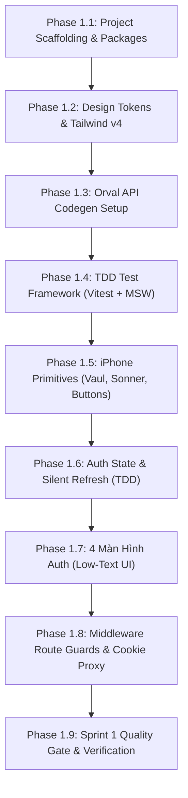

# 📋 SPRINT 1 DETAILED EXECUTION PLAN (KẾ HOẠCH CHI TIẾT SPRINT 1)

> **Mục tiêu Sprint 1**: Thiết lập nền tảng dự án Next.js 15+, hệ thống Design Tokens phẳng (Zero Blur/Shadow), cấu hình sinh API tự động (Orval + OpenAPI), hoàn thiện hạ tầng kiểm thử TDD (Vitest + MSW), các UI Primitives chuẩn iPhone và hoàn thiện 100% luồng xác thực (Login, Register, OTP 6 số, Complete Profile).  
> **Thời gian dự kiến**: 5 - 7 ngày làm việc (Gồm 8 Phase tuần tự).  
> **Cam kết chất lượng**:  
> - 🚫 **Zero Blur & Zero Shadow** (Chỉ dùng Tonal Contrast & Crisp Hairline Borders).  
> - 📏 **Mọi file $\le 700$ dòng code** (Refactor ngay khi chạm 500 dòng).  
> - 🧩 **Tuân thủ chuẩn S.O.L.I.D & DRY**.  
> - ✍️ **Giao diện ít chữ (Microcopy $\le 3$ từ)**.  
> - 🧪 **Test-Driven Development (TDD)** cho toàn bộ State & Logic Auth.

---

## 🗺️ CẤU TRÚC PHÂN ĐOÀN SPRINT 1 (WORK BREAKDOWN STRUCTURE)



---

## 🛠️ CHI TIẾT TỪNG BƯỚC THỰC THI (STEP-BY-STEP TASKS)

### PHASE 1.1: KHỞI TẠO DỰ ÁN & CÀI ĐẶT GÓI PHỤ THUỘC
- **Mục tiêu**: Tạo cấu trúc mã nguồn Next.js 15 App Router sạch sẽ và cài đặt chính xác các thư viện đã được phê duyệt.
- **Các bước thực hiện**:
  1. Chạy lệnh khởi tạo Next.js 15 tại `/Users/nguyenkimquockhanh/Desktop/checked-nextjs`:
     ```bash
     npx create-next-app@latest . --typescript --tailwind --eslint --app --src-dir --import-alias "@/*" --use-npm --skip-install
     ```
  2. Cập nhật `package.json` với danh sách dependencies chuẩn (đã được duyệt trong `TECH_STACK_AND_LIBRARIES.md`):
     - **UI & iPhone Motion**: `vaul`, `sonner`, `@number-flow/react`, `framer-motion`, `lucide-react`, `clsx`, `tailwind-merge`.
     - **State & Data**: `zustand`, `immer`, `@tanstack/react-query`, `idb-keyval`.
     - **Form & Validation**: `react-hook-form`, `zod`, `@hookform/resolvers`.
     - **Realtime, AI & Utils**: `@stomp/stompjs`, `sockjs-client`, `@google/genai`, `date-fns`.
     - **Dev & TDD**: `orval`, `openapi-typescript`, `vitest`, `@testing-library/react`, `@testing-library/jest-dom`, `@testing-library/user-event`, `msw`.
  3. Chạy `npm install` và kiểm tra tính toàn vẹn của dependency tree.
- **Tiêu chí nghiệm thu**: `npm run build` chạy không có lỗi cấu hình; `node_modules` được cài đặt đầy đủ.

---

### PHASE 1.2: CẤU HÌNH DESIGN TOKENS & TAILWIND CSS V4
- **Mục tiêu**: Định nghĩa toàn bộ hệ thống màu sắc phẳng, viền cơ học và typography chuẩn Apple iPhone trong CSS.
- **Các file tạo / chỉnh sửa**:
  - `src/app/globals.css`:
    - Định nghĩa bảng màu `@theme`: `--color-canvas: #EDE9DF`, `--color-primary: #D4EB70`, `--color-dark-surface: #141613`, `--color-surface: #FFFFFF`, `--color-surface-subtle: #DFDACD`, `--color-gray-subtle: #F2F2F4`, `--color-error: #FF6954`, `--color-success: #4E8752`.
    - Định nghĩa font stack Apple: `-apple-system, BlinkMacSystemFont, "SF Pro Rounded", "SF Pro Text"`.
    - Định nghĩa viền Hairline Retina: `border-hairline: 0.5px solid rgba(20, 22, 19, 0.12)`.
    - Khóa cuộn trang nảy ngoài ý muốn: `overscroll-behavior-y: none`.
  - `src/lib/utils/cn.ts`: Helper gộp class Tailwind an toàn bằng `clsx` và `tailwind-merge`.
- **Tiêu chí nghiệm thu**: Thử render một khối `div` với nền kem Oat Milk và nút Matcha Glow hiển thị chuẩn 100% mã màu.

---

### PHASE 1.3: CẤU HÌNH TỰ ĐỘNG SINH MÃ NGUỒN API (ORVAL CODEGEN)
- **Mục tiêu**: Thiết lập pipeline tự động đọc hợp đồng API từ Backend để sinh 100% Type-safe Hooks, loại bỏ code fetch thủ công.
- **Các file tạo**:
  - `orval.config.ts`:
    ```typescript
    import { defineConfig } from 'orval';

    export default defineConfig({
      checkedApi: {
        input: '../checked-backend/docs/openapi.yaml',
        output: {
          mode: 'split',
          target: './src/lib/api/generated/endpoints.ts',
          schemas: './src/types/api.generated.ts',
          client: 'react-query',
          override: {
            mutator: {
              path: './src/lib/api/custom-fetcher.ts',
              name: 'customFetcher',
            },
            query: {
              useQuery: true,
              useMutation: true,
              signal: true,
            },
          },
        },
      },
    });
    ```
  - `src/lib/api/custom-fetcher.ts`: Custom fetcher tự động đính kèm Token từ `useAuthStore` và xử lý silent refresh.
  - Thêm script vào `package.json`: `"codegen": "orval"`.
- **Thực thi**: Chạy `npm run codegen` để sinh toàn bộ types và hooks từ backend.
- **Tiêu chí nghiệm thu**: File `src/types/api.generated.ts` và `src/lib/api/generated/` được sinh thành công với đầy đủ models `AuthResponse`, `UserResponse`, `ExpenseEntryResponse`...

---

### PHASE 1.4: THIẾT LẬP HẠ TẦNG KIỂM THỬ TDD (VITEST + MSW)
- **Mục tiêu**: Chuẩn bị môi trường viết test trước khi viết code (Red - Green - Refactor).
- **Các file tạo**:
  - `vitest.config.ts`: Cấu hình Vitest với môi trường `jsdom`, alias `@/*` và setup file.
  - `src/test/setup.ts`: Khởi tạo `@testing-library/jest-dom`, mock Web Audio API và `navigator.vibrate`.
  - `src/test/mocks/handlers.ts`: Khởi tạo Mock Service Worker (MSW) cho các endpoint `/api/v1/auth/login`, `/api/v1/auth/register`, `/api/v1/auth/verify-otp`.
  - `src/test/mocks/server.ts`: Cấu hình MSW server cho môi trường test Node.js.
- **Tiêu chí nghiệm thu**: Chạy `npm run test`, Vitest chạy thành công với 0 test fail.

---

### PHASE 1.5: XÂY DỰNG UI PRIMITIVES PHẲNG CHUẨN IPHONE
- **Mục tiêu**: Xây dựng bộ linh kiện dùng chung không blur, không shadow, mang lại xúc giác và chuyển động cơ học chuẩn Apple.
- **Các component tạo**:
  1. `src/components/common/PrimaryButton.tsx`:
     - Nền Matcha Glow `#D4EB70`, chữ đen đậm `#141613`, bo tròn `rounded-full`.
     - Viền cơ học `border border-[#141613]/10`.
     - Tương tác co nảy Framer Motion: `whileTap={{ scale: 0.95 }}`.
     - Tích hợp gọi `hapticClick()` khi bấm.
     - Giới hạn: $< 80$ dòng code.
  2. `src/components/common/CircleIconButton.tsx`:
     - Kích thước $44x44px$ hoặc $52x52px$, nền trắng hoặc cát ấm Sand Dust `#DFDACD`.
     - Viền phẳng `border border-[#141613]/12`.
     - Icon màu đen Obsidian, nét đậm $2.2px$.
     - Giới hạn: $< 70$ dòng code.
  3. `src/components/common/CustomTextField.tsx`:
     - Nền phẳng `#F2F2F4`, bo góc `rounded-[16px]`, viền mảnh `border border-[#141613]/8`.
     - Focus: Đổi viền sang Matcha Glow `border-[#D4EB70]` (không dùng bóng sáng glow mờ).
     - Hỗ trợ hiển thị lỗi đỏ `#FF6954` ngắn gọn 1 dòng.
     - Giới hạn: $< 90$ dòng code.
  4. `src/components/common/SkeletonBone.tsx`:
     - Khung xương phẳng (Flat pulse) đổi màu nhịp nhàng giữa `#DFDACD` và `#E9E5DB`.
     - Không có vệt sáng nhòe (zero blur).
     - Giới hạn: $< 60$ dòng code.
  5. `src/components/common/BaseBottomSheet.tsx`:
     - Xây dựng trên nền **`vaul` Drawer**:
       - Kéo vuốt có lực cản quán tính (rubber-band drag physics).
       - Nền trắng phẳng `#FFFFFF`, viền đỉnh `border-t border-[#141613]/10` (zero shadow).
       - Thanh kéo phẳng `36x4px` màu `#DFDACD`.
     - Giới hạn: $< 120$ dòng code.
  6. `src/lib/utils/haptics.ts`:
     - Kích hoạt `navigator.vibrate(25)` trên thiết bị di động.
     - Web Audio Fallback: Sinh âm thanh pop click cơ học $20ms$ tần số cao $1800Hz$ khi chạy trên iOS Safari.
- **Tiêu chí nghiệm thu**: Viết Unit Test kiểm tra các component render chính xác props, accessibility và kích hoạt đúng event handlers.

---

### PHASE 1.6: QUẢN LÝ PHIÊN LÀM VIỆC & STATE AUTH (TDD FLOW)
- **Mục tiêu**: Xây dựng kho lưu trữ trạng thái đăng nhập bảo mật, tự động đồng bộ IndexedDB và tự động làm mới token ngầm.
- **Quy trình TDD bắt buộc**:
  - **Bước 1 (Red)**: Viết file test `src/stores/__tests__/auth-store.test.ts`:
    - Test `setSession` lưu `user` và `accessToken` vào state.
    - Test `logout` dọn dẹp sạch state và xóa cache IndexedDB.
    - Test tự động phục hồi session từ IndexedDB khi mở lại app.
  - **Bước 2 (Green)**: Cài đặt `src/stores/auth-store.ts`:
    - Sử dụng `zustand` + `immer` + middleware `persist`.
    - Sử dụng `idb-keyval` làm storage engine cho IndexedDB.
    - Giới hạn: $< 150$ dòng code.
  - **Bước 3 (Red)**: Viết test `src/lib/api/__tests__/auth-interceptor.test.ts` kiểm tra cơ chế tự động gửi refresh token khi API trả mã lỗi 401.
  - **Bước 4 (Green)**: Cài đặt logic refresh token trong `src/lib/api/auth-interceptor.ts`.
  - **Bước 5 (Refactor)**: Tối ưu hóa mã nguồn, đảm bảo DRY và SOLID.
- **Tiêu chí nghiệm thu**: 100% test suite của Auth Store và Interceptor đạt Green.

---

### PHASE 1.7: XÂY DỰNG 4 MÀN HÌNH XÁC THỰC (LOW-TEXT UI & FORM VALIDATION)
- **Mục tiêu**: Hoàn thiện 4 màn hình đăng nhập, đăng ký, OTP và hồ sơ theo tiêu chuẩn tối giản chữ và form validation 1 dòng bằng Zod.
- **Quy tắc Microcopy bắt buộc**: Tiêu đề $\le 2$ từ, nút bấm $\le 2$ từ, không đoạn văn thừa.

#### 1. Màn hình Đăng nhập (`src/app/(auth)/login/page.tsx`)
- Tiêu đề: **`Đăng nhập`**
- Form: React Hook Form + Zod resolver (`LoginSchema`: email hợp lệ, password $\ge 6$).
- Ô nhập: `Email`, `Mật khẩu` (icon mắt ẩn/hiện).
- Nút chính: **`Đăng nhập`** (PrimaryButton).
- Nút phụ: **`Tạo tài khoản`** (chuyển sang `/register`).
- Giới hạn: $< 140$ dòng code.

#### 2. Màn hình Đăng ký (`src/app/(auth)/register/page.tsx`)
- Tiêu đề: **`Đăng ký`**
- Form: `RegisterSchema` (`email`, `username`, `password`).
- Nút chính: **`Tiếp tục`**.
- Nút phụ: **`Đã có tài khoản`** (chuyển sang `/login`).
- Giới hạn: $< 150$ dòng code.

#### 3. Màn hình Xác thực OTP (`src/app/(auth)/verify-otp/page.tsx`)
- Tiêu đề: **`Nhập mã 6 số`**
- Dòng chữ phụ nhỏ: `gửi tới user@email.com`.
- Component `OTPInput` (`src/components/auth/OTPInput.tsx`):
  - 6 ô vuông $48x54px$, nền `#F2F2F4`, viền cơ học `border border-[#141613]/12`.
  - Tự động nhảy focus sang ô kế tiếp.
  - Hỗ trợ dán (paste) chuỗi 6 ký tự.
  - Nhập đủ 6 số tự động gọi API verify mà không cần bấm nút.
- Đếm ngược: `Gửi lại sau 60s` $\rightarrow$ Nút `Gửi lại mã`.
- Giới hạn: $< 160$ dòng code (OTPInput $< 120$ dòng).

#### 4. Màn hình Hoàn thiện Hồ sơ (`src/app/(auth)/complete-profile/page.tsx`)
- Tiêu đề: **`Hồ sơ của bạn`**
- Avatar Picker: Vòng tròn $120x120px$, viền đôi sắc nét, cho phép chọn ảnh từ thiết bị và cắt vuông 1:1 bằng Canvas.
- Ô nhập: `Tên hiển thị` (displayName).
- Nút chính: **`Bắt đầu`**.
- Giới hạn: $< 180$ dòng code.

---

### PHASE 1.8: MIDDLEWARE ROUTE GUARDS & PROXY COOKIE
- **Mục tiêu**: Điều hướng phiên làm việc tự động và bảo mật Refresh Token trong HTTP-Only Cookie.
- **Các file tạo**:
  - `src/middleware.ts`:
    - Public paths: `['/login', '/register', '/verify-otp', '/invite']`.
    - Kiểm tra cookie session:
      - Chưa đăng nhập truy cập trang protected $\rightarrow$ Chuyển hướng về `/login?redirect=...`.
      - Đã đăng nhập nhưng `profileCompleted === false` $\rightarrow$ Ép chuyển hướng về `/complete-profile`.
      - Đã đăng nhập truy cập `/login` hoặc `/register` $\rightarrow$ Chuyển về `/`.
    - Giới hạn: $< 90$ dòng code.
  - `src/app/api/auth/session/route.ts`: API Route nhận token từ client và ghi vào HTTP-Only Cookie.
  - `src/app/api/auth/refresh/route.ts`: API Route đọc Refresh Token từ Cookie và gọi backend lấy Access Token mới.

---

### PHASE 1.9: SPRINT 1 QUALITY GATE & AUDIT
- **Mục tiêu**: Nghiệm thu độc lập toàn bộ các tiêu chuẩn kỹ thuật trước khi kết thúc Sprint 1.
- **Checklist kiểm định**:
  1. [ ] **Test Coverage**: Chạy `npm run test` $\rightarrow$ 100% test pass.
  2. [ ] **Zero Blur & Zero Shadow Audit**: Chạy lệnh grep kiểm tra:
     ```bash
     grep -rn "shadow" src/
     grep -rn "blur" src/
     ```
     Kết quả phải là **0 kết quả** trong CSS và JSX styling.
  3. [ ] **File Length Audit**: Chạy lệnh kiểm tra độ dài file:
     ```bash
     find src -name "*.tsx" -o -name "*.ts" | xargs wc -l
     ```
     Không có bất kỳ file nào vượt quá **700 dòng** (Mục tiêu lý tưởng $\le 200$ dòng).
  4. [ ] **Microcopy Audit**: Toàn bộ tiêu đề màn hình và nút bấm trên 4 màn hình auth $\le 3$ từ.
  5. [ ] **E2E Manual Walkthrough**: Đăng ký tài khoản $\rightarrow$ Nhập OTP $\rightarrow$ Upload avatar & đặt tên $\rightarrow$ Vào Home.
  6. [ ] **Git Commit**: Commit toàn bộ mã nguồn Sprint 1 với thông điệp rõ ràng theo chuẩn Conventional Commits.

---

## 📊 BẢNG THEO DÕI TIẾN ĐỘ SPRINT 1 (PROGRESS TRACKER)

| Task ID | Nội Dung Công Việc | Phân Loại | Trạng Thái | Người Phụ Trách |
| :---: | :--- | :---: | :---: | :---: |
| **1.1** | Setup Next.js 15, Tailwind v4 & Dependencies | Infra | ⏳ Sẵn sàng | Antigravity AI |
| **1.2** | Cấu hình `@theme` Oat Milk & Matcha Glow | Design System | ⏳ Sẵn sàng | Antigravity AI |
| **1.3** | Cấu hình Orval API Codegen từ `openapi.yaml` | Codegen | ⏳ Sẵn sàng | Antigravity AI |
| **1.4** | Thiết lập Vitest + MSW Mock Testing | Testing / TDD | ⏳ Sẵn sàng | Antigravity AI |
| **1.5** | Xây dựng 6 UI Primitives phẳng chuẩn iPhone | Components | ⏳ Sẵn sàng | Antigravity AI |
| **1.6** | Cài đặt `useAuthStore` & Silent Refresh (TDD) | State / Logic | ⏳ Sẵn sàng | Antigravity AI |
| **1.7** | Xây dựng 4 màn hình Auth (Login, Register, OTP, Profile) | Screen / UI | ⏳ Sẵn sàng | Antigravity AI |
| **1.8** | Xây dựng Middleware Route Guards & Cookie Proxy | Security | ⏳ Sẵn sàng | Antigravity AI |
| **1.9** | Audit 5 Quality Gates & Đóng Sprint 1 | QA / Review | ⏳ Sẵn sàng | Antigravity AI |
