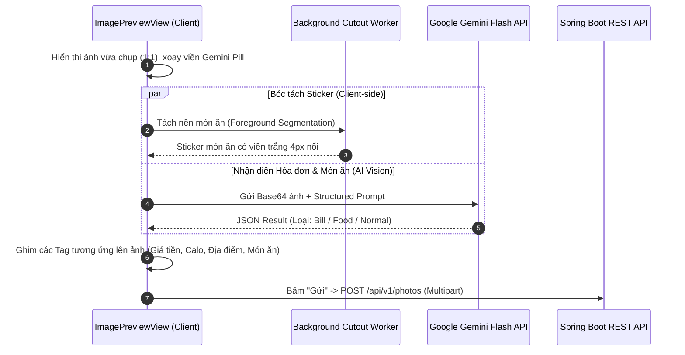

# 🖼️ XEM TRƯỚC ẢNH, GEMINI AI VISION & 5 SHEETS CHỈNH SỬA

Sau khi người dùng chụp ảnh hoặc chọn ảnh từ thư viện, màn hình `ImagePreviewView` sẽ hiển thị toàn màn hình với tỷ lệ khung ảnh khớp 100% với khung ngắm camera vừa chụp.

---

## 1. QUY TRÌNH PHÂN TÍCH THỊ GIÁC AI (VISION COORDINATION)

---

## 2. GIAO DIỆN & CÁC TAG GHIM NỔI TRÊN ẢNH (PINNED TAGS)

Các thẻ tag hiển thị như những con nhộng thủy tinh mờ (Glassmorphism) ghim nổi trên bức ảnh:
- **Thẻ Hóa đơn / Giá tiền**: Biểu tượng biên lai `Receipt` + Số tiền định dạng chuẩn (ví dụ: `125.000đ`). Chạm vào mở `BillDetailSheet` hoặc `PriceEditSheet`.
- **Thẻ Tên Món ăn**: Biểu tượng nĩa muỗng `Utensils` + Tên món ăn (ví dụ: "Phở Bò Tái Nạm"). Chạm vào mở `FoodEditSheet`.
- **Thẻ Năng lượng Calo**: Biểu tượng ngọn lửa `Flame` + Lượng calo (ví dụ: "580 kcal · 28g Đạm"). Chạm vào mở `CalorieEditSheet`.
- **Thẻ Địa điểm**: Biểu tượng định vị `MapPin` + Tên quán (lấy từ GPS Geolocation hoặc gõ tay). Chạm vào mở `LocationEditSheet`.

---

## 3. ĐẶC TẢ 5 BOTTOM SHEETS CHỈNH SỬA

### 3.1 `BillDetailSheet` (Chỉnh Sửa Chi Tiết Hóa Đơn & Chia Tiền)
- Tên quán / Cửa hàng: Cho phép chỉnh sửa nhanh.
- Tổng số tiền: Ô nhập tiền tệ to rõ ràng kèm phím tắt cộng tiền nhanh (+10k, +50k, +100k).
- Danh sách từng món trong hóa đơn (Tên món, số lượng, đơn giá).
- Thuế VAT và Tiền phục vụ.
- **Tính năng Chia Tiền (Split Bill)**:
  - Chọn danh sách bạn bè cùng ăn.
  - Tự động chia đều hoặc chia theo từng món cụ thể.

### 3.2 `FoodEditSheet` (Chỉnh Sửa Món Ăn)
- Ô nhập tên món ăn tiếng Việt.
- Lưới chọn nhóm ẩm thực phổ biến: Cơm, Phở/Bún/Mì, Đồ uống/Cafe/Trà sữa, Đồ ăn vặt, Tráng miệng, Fastfood...
- Gợi ý icon danh mục tương ứng.

### 3.3 `CalorieEditSheet` (Chỉnh Sửa Dinh Dưỡng)
- Con trượt điều chỉnh số Calo ($0$ đến $2000$ kcal).
- 3 trường nhập chi tiết đa lượng (Macros): Đạm (Protein - g), Đường bột (Carbs - g), Chất béo (Fat - g).

### 3.4 `PriceEditSheet` (Gắn Thẻ Giá Tiền Nhanh)
- Bàn phím số lớn chuyên dụng để nhập số tiền (VNĐ).
- Gợi ý các mệnh giá tiền giấy Việt Nam thông dụng (20k, 50k, 100k, 200k, 500k).

### 3.5 `LocationEditSheet` (Địa Điểm Quán Ăn)
- Hiển thị vị trí GPS hiện tại do trình duyệt xác định (`navigator.geolocation`).
- Nút bấm "Làm mới GPS".
- Ô tìm kiếm tên quán ăn / địa điểm thủ công.

