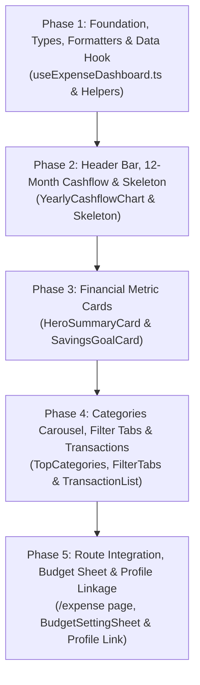

# 📋 KẾ HOẠCH TỔNG THỂ (MASTER PLAN): EXPENSE DASHBOARD (`/expense`)
## Bảng Điều Khiển Chi Tiêu & Quản Lý Tài Chính — Checked Next.js
### Chuẩn Parity 1:1 với iOS (`ExpenseDashboardView.swift` & `ExpenseDashboardViewModel.swift`)

> **Mục tiêu**: Xây dựng toàn diện trang Dashboard Chi tiêu & Tài chính tại [`/expense`](src/app/expense/page.tsx) đạt độ chuẩn xác 100% về giao diện, luồng tương tác và tính năng so với bản native iOS:
> 1. **Header Bar Flat**: Nút Back tròn $44 \times 44\text{px}$ nền trắng, tiêu đề `"Chi tiêu"` tròn trịa đậm nét.
> 2. **Dòng Tiền 12 Tháng (Yearly Cashflow Selector)**: Bộ chọn tháng dạng mini bar chart 12 tháng cả năm ($T1 \dots T12$), dual-bars Thu (Matcha Glow) & Chi (Đen), nút chuyển năm `< Dòng tiền YYYY >`.
> 3. **Hero Summary Card**: Tổng chi tiêu tháng font to đậm (Tabular Numbers), thanh tiến độ ngân sách 8px (đổi màu đỏ cảnh báo khi vượt), 3 cột chỉ số tài chính (Thu nhập, Chi tiêu, Thuần).
> 4. **Savings Goal Card**: Thẻ mục tiêu tiết kiệm, thanh tiến độ 6px, nút bấm mở nhanh cài đặt mục tiêu.
> 5. **Top Categories Carousel**: Hàng thẻ danh mục cuộn ngang kèm icon tròn $32 \times 32\text{px}$, tỷ lệ % và số tiền chi.
> 6. **Transaction Filter Tabs & List**: 3 pills `[Tất cả | Chi tiêu | Thu nhập]`, danh sách thẻ giao dịch phẳng độc lập kèm thumbnail hóa đơn, xem ảnh phóng to full-screen khi chạm, hỗ trợ phân trang vô tận.
> 7. **Tích hợp `BudgetSettingSheet`**: Chạm vào tiến độ ngân sách hoặc mục tiêu tiết kiệm sẽ mở sheet điều chỉnh trực tiếp.
> 8. **Đồng bộ điều hướng từ `/profile`**: Chạm thẻ Ngân sách tháng trên Profile sẽ điều hướng mượt sang `/expense` (chuẩn `coordinator.openExpense()`).

---

### Quy Tắc Thiết Kế Cốt Lõi (Strict Constraints)
- **Zero Border, Zero Blur, Zero Shadow**: Tuyệt đối không dùng `border-*`, `blur-*`, `shadow-*`. Tách mảng bằng kỹ thuật *Tonal Layering*: Canvas Oat Milk `#EDE9DF`, Surface `#FFFFFF`, Surface Subtle `#DFDACD`, Gray Subtle `#F2F2F4`, Primary Matcha Glow `#D4EB70`, Error `#FF6954`, Success `#4E8752`.
- **Max Lines per File**: Mọi component, hook, helper tối đa 700 dòng (mục tiêu lý tưởng < 250 dòng).
- **Haptic & Fluid Feedback**: Tích hợp phản hồi rung cảm ứng `haptics.click()`, `haptics.selection()`.
- **Stale-While-Revalidate & Skeleton Shimmer**: Tận dụng TanStack React Query cache tức thì, hiển thị Skeleton zero layout shift khi chưa có dữ liệu.
- **TDD (Test-Driven Development)**: Mỗi phase đều có unit/integration tests kiểm thử tự động độc lập.

---

## 🗺️ LỘ TRÌNH 5 PHASES THỰC HIỆN

---

## 🟢 CHI TIẾT CÁC PHASES & DANH SÁCH TASKS

### 📍 Phase 1: Foundation, Types, Formatters & Data Hook (`useExpenseDashboard`)
- **Mục tiêu**: Xây dựng các kiểu dữ liệu, hàm định dạng tiền tệ rút gọn, ngày giờ thông minh và hook TanStack Query kết nối các endpoints chi tiêu của backend.
- **Tasks**:
  - [x] **Task 1.1**: Định nghĩa Types & DTOs cho phân hệ Expense (`src/types/expense.ts`). (ĐÃ HOÀN THÀNH)
  - [x] **Task 1.2**: Xây dựng Formatters & Category Icon Mappers (`src/lib/utils/expense-formatters.ts`). (ĐÃ HOÀN THÀNH)
  - [x] **Task 1.3**: Xây dựng Hook điều phối dữ liệu `useExpenseDashboard.ts` (`src/hooks/useExpenseDashboard.ts`). (ĐÃ HOÀN THÀNH)
  - [x] **Task 1.4**: Unit Tests cho Phase 1 (`src/lib/utils/__tests__/expense-formatters.test.ts`, `src/hooks/__tests__/useExpenseDashboard.test.ts`). (ĐÃ HOÀN THÀNH)

### 📍 Phase 2: Header Bar, 12-Month Yearly Cashflow Selector & Skeleton View
- **Mục tiêu**: Tái hiện thanh Header phẳng với nút back tròn $44 \times 44\text{px}$, bộ điều khiển dòng tiền 12 tháng cả năm (chọn tháng trực quan qua mini dual-bar chart), và giao diện Skeleton Shimmer chống giật layout.
- **Tasks**:
  - [x] **Task 2.1**: Xây dựng Component `ExpenseHeaderBar.tsx` (`src/components/expense/ExpenseHeaderBar.tsx`). (ĐÃ HOÀN THÀNH)
  - [x] **Task 2.2**: Xây dựng Component bộ chọn dòng tiền 12 tháng `YearlyCashflowChart.tsx` (`src/components/expense/YearlyCashflowChart.tsx`). (ĐÃ HOÀN THÀNH)
  - [x] **Task 2.3**: Xây dựng Skeleton View `ExpenseDashboardSkeleton.tsx` (`src/components/expense/ExpenseDashboardSkeleton.tsx`). (ĐÃ HOÀN THÀNH)
  - [x] **Task 2.4**: Unit Tests cho Phase 2 components. (ĐÃ HOÀN THÀNH)

### 📍 Phase 3: Financial Metric Cards (Hero Summary & Savings Goal)
- **Mục tiêu**: Xây dựng 2 thẻ chỉ số tài chính trung tâm: Thẻ Tổng chi tiêu Hero Card (tiến độ ngân sách 8px, 3 cột Thu/Chi/Thuần) và Thẻ Mục tiêu tiết kiệm (thanh progress 6px, cờ mục tiêu).
- **Tasks**:
  - [x] **Task 3.1**: Xây dựng Thẻ Hero Tổng chi tiêu `ExpenseHeroSummaryCard.tsx` (`src/components/expense/ExpenseHeroSummaryCard.tsx`). (ĐÃ HOÀN THÀNH)
  - [x] **Task 3.2**: Xây dựng Thẻ Mục tiêu tiết kiệm `ExpenseSavingsGoalCard.tsx` (`src/components/expense/ExpenseSavingsGoalCard.tsx`). (ĐÃ HOÀN THÀNH)
  - [x] **Task 3.3**: Unit Tests cho Phase 3 components. (ĐÃ HOÀN THÀNH)

### 📍 Phase 4: Categories Carousel, Filter Tabs & Transaction List
- **Mục tiêu**: Xây dựng thanh cuộn ngang Top danh mục, 3 tabs bộ lọc giao dịch, danh sách thẻ giao dịch phẳng kèm thumbnail ảnh bill, và modal phóng to ảnh bill toàn màn hình.
- **Tasks**:
  - [x] **Task 4.1**: Xây dựng Thẻ cuộn Top danh mục `TopCategoriesSection.tsx` (`src/components/expense/TopCategoriesSection.tsx`). (ĐÃ HOÀN THÀNH)
  - [x] **Task 4.2**: Xây dựng Bộ lọc giao dịch `TransactionFilterTabs.tsx` (`src/components/expense/TransactionFilterTabs.tsx`). (ĐÃ HOÀN THÀNH)
  - [x] **Task 4.3**: Xây dựng Danh sách giao dịch `TransactionListSection.tsx` (`src/components/expense/TransactionListSection.tsx`). (ĐÃ HOÀN THÀNH)
  - [x] **Task 4.4**: Xây dựng Modal xem ảnh phóng to `ReceiptPhotoModal.tsx` (`src/components/expense/ReceiptPhotoModal.tsx`). (ĐÃ HOÀN THÀNH)
  - [x] **Task 4.5**: Unit Tests cho Phase 4 components. (ĐÃ HOÀN THÀNH)

### 📍 Phase 5: Route Integration (`/expense`), Budget Sheet, Profile Linkage & Final Build
- **Mục tiêu**: Hoàn thiện trang chính `/expense`, tích hợp xác thực Route Guard, gắn modal `BudgetSettingSheet`, cập nhật link từ trang `/profile`, viết Integration Test Suite và chạy `npm run build` kiểm tra toàn diện.
- **Tasks**:
  - [x] **Task 5.1**: Tạo Barrel export `src/components/expense/index.ts`. (ĐÃ HOÀN THÀNH)
  - [x] **Task 5.2**: Xây dựng Trang chính `src/app/expense/page.tsx`. (ĐÃ HOÀN THÀNH)
  - [x] **Task 5.3**: Cập nhật điều hướng từ thẻ Chi tiêu trên trang `src/app/profile/page.tsx` sang `/expense`. (ĐÃ HOÀN THÀNH)
  - [x] **Task 5.4**: Xây dựng Integration Test Suite `src/app/expense/__tests__/expense-page.test.tsx`. (ĐÃ HOÀN THÀNH)
  - [x] **Task 5.5**: Kiểm tra tổng thể toàn bộ dự án (`npx tsc --noEmit`, `npm test`, `npm run build`). (ĐÃ HOÀN THÀNH)

---

## 📌 BẢNG ĐỐI CHIẾU THÀNH PHẦN (iOS vs NEXT.JS)

| Thành phần trên iOS (`ExpenseDashboardView.swift`) | Component Next.js (`checked-nextjs`) | Đường dẫn & Kỹ thuật |
| :--- | :--- | :--- |
| `headerBar` | `ExpenseHeaderBar.tsx` | Nút tròn 44x44, title "Chi tiêu" |
| `yearlyCashflowSection` | `YearlyCashflowChart.tsx` | Chuyển năm, mini dual-bar 12 tháng |
| `heroSummaryCard` | `ExpenseHeroSummaryCard.tsx` | Con số lớn, tiến độ 8px, 3 cột tài chính |
| `savingsGoalCard` | `ExpenseSavingsGoalCard.tsx` | Cờ mục tiêu, progress 6px, nút Sửa/Đặt |
| `topCategoriesSection` | `TopCategoriesSection.tsx` | Cuộn ngang thẻ 124x96, icon 32x32 |
| `filterTabsSection` | `TransactionFilterTabs.tsx` | 3 Capsule pills [Tất cả \| Chi tiêu \| Thu nhập] |
| `transactionListSection` | `TransactionListSection.tsx` | Từng card phẳng riêng biệt, thumbnail 44x44 |
| `photoPreviewOverlay` | `ReceiptPhotoModal.tsx` | Modal overlay phóng to ảnh hóa đơn |
| `ExpenseDashboardSkeletonView` | `ExpenseDashboardSkeleton.tsx` | Skeleton zero layout shift |
| `BudgetSettingSheet` | `BudgetSettingSheet.tsx` (Tái sử dụng) | Cập nhật hạn mức & tiết kiệm |
