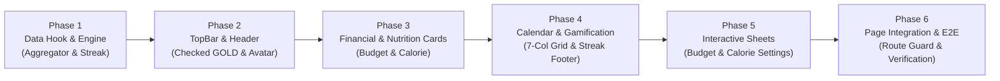

# 📋 KẾ HOẠCH TRIỂN KHAI CHI TIẾT THEO PHASE: PROFILE SCREEN
## Phân Hệ Màn Hình Trang Cá Nhân (`/profile`) — Checked Next.js
### Chuẩn Parity 1:1 với iOS (`ProfileView.swift`) & Backend (`checked-backend`)

> **Mục tiêu dự án**: Xây dựng toàn diện trải nghiệm trang cá nhân của tôi (`/profile`) đạt chuẩn 100% native app như `checked-ios`: Huy hiệu **Checked GOLD**, Thẻ **Ngân sách tháng**, Thẻ **Năng lượng Calo hôm nay**, Thẻ **Lưới lịch 7 cột** gom bài đăng 1:1 kèm Dot Badge xanh Matcha Glow, **Stats Footer** chuỗi ngày streak, và 2 **Bottom Sheets** thiết lập ngân sách / calo trực tiếp.
>
> **Quy tắc thiết kế cốt lõi (Strict Constraints)**:
> 1. **Zero Border, Zero Blur, Zero Shadow**: Tuyệt đối không dùng `border-*`, `blur-*`, `shadow-*`. Tách mảng bằng màu phẳng phân cấp (*Tonal Layering*: Canvas Oat Milk `#EDE9DF`, Surface `#FFFFFF`, Surface Subtle `#DFDACD`, Primary Matcha Glow `#D4EB70`).
> 2. **Max 700 lines/file**: Tách nhỏ các component card, hook và sheet dưới 200 dòng.
> 3. **Haptic & Fluid Interaction**: Tích hợp phản hồi rung cảm ứng xúc giác (`haptics.click()`, `haptics.selection()`).
> 4. **Two-tier Data Loading**: Ưu tiên tải nhanh dữ liệu tổng quan (Critical First-paint), sau đó lazy load chi tiết lịch sử ảnh khi tương tác.
> 5. **TDD & Zero Regression**: Mỗi phase đều đi kèm Unit Tests và lệnh kiểm thử độc lập trước khi sang phase tiếp theo.

---

## 🗺️ LỘ TRÌNH TỔNG QUAN 6 PHASES



---

## 🟢 PHASE 1: CORE LOGIC, DATA HOOK & POST AGGREGATOR ENGINE
> **Mục tiêu**: Xây dựng tầng dữ liệu độc lập, các hàm format tiền tệ/tháng, thuật toán gom nhóm ảnh bài post theo ngày trong tháng và thuật toán tính chuỗi ngày liên tiếp (Streak).

### Bảng Đối Chiếu Tính Năng:
| Khái niệm trên iOS (`ProfileView.swift`) | Triển khai trên Next.js (`checked-nextjs`) | Ghi chú kỹ thuật |
| :--- | :--- | :--- |
| `DayCalendarData(latestImageUrl, latestDate, postCount)` | `interface DayCalendarData` | Lưu bài đăng mới nhất và tổng số bài đăng trong ngày |
| `updateCalendarData(entries, myPhotos)` | `aggregateCalendarData(...)` | Lọc ảnh theo `yyyyMM`, khử trùng lặp và nhóm theo ngày 1..31 |
| `calculateStreak(calendarData)` | `calculateStreakDays(...)` | Đếm lùi liên tiếp từ ngày hiện tại; chặn đứt quãng |
| `formatCurrency(Double)` | `formatCurrencyVND(number)` | Định dạng chuẩn tiền tệ Việt Nam (ví dụ: `150.000₫`) |
| `currentMonthString` (`LLLL yyyy`) | `formatCurrentMonthVi(date)` | Định dạng tiếng Việt viết hoa: `"Tháng 10 2026"` |

### Danh Sách Công Việc (Tasks):
- [ ] **Task 1.1: Định nghĩa Types & Formatters chuẩn**
  - **File**: `src/types/profile.ts`
  - **File**: `src/lib/utils/formatters.ts`
  - **Mô tả**:
    - Khai báo kiểu `DayCalendarData`: `{ latestImageUrl: string; latestDate: Date; postCount: number }`.
    - Khai báo kiểu `ProfileSummaryState`: `totalSpent`, `budgetLimit`, `alertPct`, `savingsTarget`, `todayCalories`, `targetCalories`, `calorieExceeded`, `caloriePercentage`.
    - Viết hàm `formatCurrencyVND`: định dạng số nguyên sang `X.XXX.XXX₫`.
    - Viết hàm `formatCurrentMonthVi`: chuyển `Date` thành `"Tháng M YYYY"`.
  - **Verifiable**: Unit tests định dạng tiền và ngày tháng pass 100%.

- [ ] **Task 1.2: Xây dựng Helper gom nhóm ảnh & Thuật toán tính Streak**
  - **File**: `src/lib/profile/calendar-aggregator.ts`
  - **Mô tả**:
    - `aggregateCalendarData(entries, myPhotos, targetDate)`: Nhận danh sách giao dịch chi tiêu có ảnh và bài đăng khoảnh khắc, lọc theo năm & tháng của `targetDate`. Nhóm theo `day` (1 đến `daysInMonth`). Sắp xếp lấy bài post mới nhất và tính `postCount`.
    - `calculateStreakDays(calendarData, today)`: Bắt đầu từ ngày hiện tại, nếu hôm nay chưa đăng thì xét từ hôm qua, đếm lùi liên tiếp chừng nào ngày đó có bài post. Trả về tối thiểu 1.
  - **Verifiable**: Unit test kiểm tra trường hợp không có ảnh, có nhiều ảnh cùng ngày, và đứt quãng streak.

- [ ] **Task 1.3: Xây dựng Hook `useProfileData.ts` (Two-Tier Data Fetching)**
  - **File**: `src/hooks/useProfileData.ts`
  - **Mô tả**:
    - **Tầng 1 (Tóm tắt nhanh)**: Gọi đồng thời qua TanStack Query:
      - `getCashflowSummary({ monthKey })`
      - `getBudget(monthKey)`
      - `getSavingsGoal(monthKey)`
      - `getGoal()` (Calorie target)
      - `getDailySummary({ date: todayDateString })`
    - **Tầng 2 (Lịch sử chi tiết)**: Gọi `getExpenseEntries` (`type: 'ALL', size: 30`) và `getMyPhotos({ size: 30 })`.
    - Kết hợp `aggregateCalendarData` để xuất ra `dayCalendarData`, `checkedCount`, `streakDays`.
    - Cung cấp trạng thái `isLoadingSummary` và `isLoadingCalendar`.
  - **Verifiable**: Hook test với Mock query client trả về đầy đủ state tóm tắt và dữ liệu lịch.

- [ ] **Task 1.4: Unit Tests cho Phase 1**
  - **Files**:
    - `src/lib/profile/__tests__/calendar-aggregator.test.ts`
    - `src/hooks/__tests__/useProfileData.test.ts`
  - **Verifiable**: `npm test -- aggregator` và `npm test -- useProfileData` vượt qua 100%.

---

## 🟢 PHASE 2: TOP NAVIGATION BAR & USER IDENTITY HEADER
> **Mục tiêu**: Tái hiện chính xác thanh điều hướng AppBar chuẩn iOS (Huy hiệu "Checked GOLD" + 3 nút thao tác) và khung thông tin cá nhân (Avatar 80x80 viền xanh Matcha Glow + Display Name + @username).

### Bảng Đối Chiếu Tính Năng:
| Khái niệm trên iOS (`ProfileView.swift`) | Triển khai trên Next.js (`checked-nextjs`) | Ghi chú kỹ thuật |
| :--- | :--- | :--- |
| `appBar` | `ProfileTopBar.tsx` | Chiều cao 44px, padding ngang 16px, nút bấm bo góc có haptic |
| Huy hiệu `'Checked GOLD'` | `CheckedGoldBadge` component | Font 12pt bold rounded, chữ màu `#D4EB70`, viền bo góc 12px viền 1.5px |
| Nút `person.2.fill` | Nút `Users` icon (Lucide) | Kích thước 40x40px, điều hướng sang `/messages` |
| Nút `gearshape.fill` | Nút `Settings` icon (Lucide) | Kích thước 40x40px, điều hướng sang `/settings` |
| Nút `chevron.right` | Nút `ChevronRight` / `X` icon | Kích thước 40x40px, quay trở lại camera chính (`/`) |
| `profileHeader` | `ProfileHeader.tsx` | Avatar tròn 80x80px viền xanh 2px, padding 3px, ảnh 70x70px |

### Danh Sách Công Việc (Tasks):
- [ ] **Task 2.1: Tạo Component `ProfileTopBar.tsx`**
  - **File**: `src/components/profile/ProfileTopBar.tsx`
  - **Mô tả**:
    - Render container `w-full h-11 flex items-center justify-between px-4 z-20 select-none`.
    - Bên trái: Huy hiệu `Checked GOLD` pill: `px-3 py-1 rounded-xl border-[1.5px] border-primary text-[12px] font-bold font-display text-primary`.
    - Bên phải: 3 nút icon (40x40px, flex items-center justify-center):
      1. Nút Bạn bè: icon `Users` size 20 $\rightarrow$ gọi `onFriendsClick`.
      2. Nút Cài đặt: icon `Settings` size 20 $\rightarrow$ gọi `onSettingsClick`.
      3. Nút Đóng: icon `ChevronRight` size 22 $\rightarrow$ gọi `onCloseClick`.
    - Áp dụng micro-interaction: `active:scale-95 transition-transform duration-100` và rung `haptics.click()`.
  - **Verifiable**: Component render đúng 3 nút và badge vàng/xanh, trigger đúng sự kiện khi click.

- [ ] **Task 2.2: Tạo Component `ProfileHeader.tsx`**
  - **File**: `src/components/profile/ProfileHeader.tsx`
  - **Mô tả**:
    - Nhận props: `displayName`, `username`, `avatarUrl`.
    - Khối Avatar 80x80px:
      - Vòng tròn ngoài viền Matcha Glow: `w-20 h-20 rounded-full border-2 border-primary flex items-center justify-center p-[3px]`.
      - Ảnh bên trong 70x70px: `w-[70px] h-[70px] rounded-full object-cover`.
      - Placeholder fallback: nếu không có avatar thì hiển thị nền `bg-gray-subtle` cùng icon `User` size 28 màu `text-secondary`.
    - Cột văn bản (bên phải avatar, spacing 20px):
      - `displayName`: `text-[24px] font-bold font-display text-text-primary leading-tight`.
      - `@username`: `text-[16px] font-normal text-text-secondary`.
  - **Verifiable**: Hiển thị avatar tròn đúng tỷ lệ, sắc nét trên màn hình retina di động.

- [ ] **Task 2.3: Unit Tests cho Phase 2**
  - **Files**:
    - `src/components/profile/__tests__/profile-top-bar.test.tsx`
    - `src/components/profile/__tests__/profile-header.test.tsx`
  - **Verifiable**: `npm test -- profile-top-bar` và `npm test -- profile-header` passed 100%.

---

## 🟢 PHASE 3: FINANCIAL & NUTRITIONAL INTELLIGENCE CARDS
> **Mục tiêu**: Xây dựng 2 thẻ thông tin cốt lõi: Thẻ Ngân Sách Tháng (`BudgetSummaryCard`) và Thẻ Năng Lượng Hôm Nay (`CalorieSummaryCard`) với thanh tiến độ thông minh đổi màu và trạng thái skeleton loading.

### Bảng Đối Chiếu Tính Năng:
| Khái niệm trên iOS (`ProfileView.swift`) | Triển khai trên Next.js (`checked-nextjs`) | Ghi chú kỹ thuật |
| :--- | :--- | :--- |
| `budgetCard` | `BudgetSummaryCard.tsx` | Khối thẻ `bg-surface rounded-card p-5`, click mở sheet hoặc điều hướng |
| Đổi màu tiến độ chi tiêu | Dynamic progress fill | Xanh Matcha Glow nếu trong hạn mức, chuyển sang **Đỏ `#FF5252`** nếu vượt |
| Cảnh báo vượt ngưỡng 80% | Warning pill/row | Icon `AlertTriangle` + `"Đã chạm ngưỡng cảnh báo 80%"` |
| Mục tiêu tiết kiệm | Savings row | Icon `Flag` + `"Mục tiêu tiết kiệm: X₫"` |
| `calorieCard` | `CalorieSummaryCard.tsx` | Khối thẻ `bg-surface rounded-card p-5`, hiển thị Kcal nạp vs mục tiêu |
| Đổi màu tiến độ calo | Dynamic calorie fill | Xanh Matcha Glow nếu chưa vượt, chuyển sang **Đỏ `#FF5252`** nếu vượt Kcal |
| Skeleton Bone State | `SkeletonBone` | Hiển thị 4 thanh giả lập khi dữ liệu đang tải ban đầu |

### Danh Sách Công Việc (Tasks):
- [ ] **Task 3.1: Xây dựng `BudgetSummaryCard.tsx` (Thẻ Chi Tiêu Tháng)**
  - **File**: `src/components/profile/BudgetSummaryCard.tsx`
  - **Mô tả**:
    - Khối thẻ `bg-surface rounded-card p-5 select-none active:scale-[0.99] transition-transform`.
    - Hàng 1: Icon ví `CreditCard` tròn 26x26 xám mờ + chữ "Chi tiêu tháng này" 14px medium + `ChevronRight` xám 14px.
    - Hàng 2: Số tiền đã chi `28px font-bold font-display` + `/ {limit}` (hoặc `"/ Chưa đặt hạn mức"` 14px medium).
    - Hàng 3: Thanh tiến độ capsule `h-2 bg-gray-subtle rounded-full overflow-hidden`. Chiều rộng fill `min(100, percentUsed)%`. Màu xanh `bg-primary`, nếu vượt hạn mức đổi sang `bg-error` (`#FF5252`).
    - Hàng 4:
      - Nếu có hạn mức: Trái `Tiến độ: X%` (12px semibold text-secondary); Phải `Còn lại: X₫` (xanh `#27AE60`) hoặc `Vượt: X₫` (đỏ `#FF5252`).
      - Nếu chưa có hạn mức: `"Chạm để xem chi tiết & thiết lập hạn mức"` (13px medium text-secondary).
    - Hàng 5 (nếu có `savingsTarget > 0`): Icon `Flag` 12px + `"Mục tiêu tiết kiệm: X₫"`.
    - Hàng 6 (nếu `percentUsed >= alertPct` và chưa vượt): Icon `AlertTriangle` 12px + `"Đã chạm ngưỡng cảnh báo X%"`.
    - Tích hợp trạng thái `SkeletonBone` khi `isLoading == true`.
  - **Verifiable**: Unit tests kiểm tra đầy đủ các trạng thái: chưa đặt hạn mức, trong hạn mức, chạm cảnh báo 80%, vượt hạn mức.

- [ ] **Task 3.2: Xây dựng `CalorieSummaryCard.tsx` (Thẻ Năng Lượng Hôm Nay)**
  - **File**: `src/components/profile/CalorieSummaryCard.tsx`
  - **Mô tả**:
    - Khối thẻ `bg-surface rounded-card p-5 select-none active:scale-[0.99] transition-transform`.
    - Hàng 1: Icon ngọn lửa `Flame` tròn 26x26 xám mờ + "Năng lượng hôm nay" 14px medium + `ChevronRight` 14px.
    - Hàng 2: Số calo nạp `{todayCalories} kcal` (28px font-bold font-display) + `/ {targetCalories} kcal` (14px medium).
    - Hàng 3: Thanh tiến độ capsule `h-2 bg-gray-subtle rounded-full overflow-hidden`. Chiều rộng fill `min(100, caloriePercentage)%`. Màu `bg-primary` (bình thường) hoặc `bg-error` (vượt).
    - Hàng 4: Trái `Tiến độ: X%` (12px semibold); Phải `Còn lại: X kcal` (xanh) hoặc `Vượt: X kcal` (đỏ).
    - Tích hợp trạng thái `SkeletonBone` khi `isLoading == true`.
  - **Verifiable**: Unit tests kiểm tra hiển thị calo nạp, tính đúng % và đổi màu khi vượt mức.

- [ ] **Task 3.3: Unit Tests cho Phase 3**
  - **Files**:
    - `src/components/profile/__tests__/budget-summary-card.test.tsx`
    - `src/components/profile/__tests__/calorie-summary-card.test.tsx`
  - **Verifiable**: `npm test -- budget-summary-card` và `npm test -- calorie-summary-card` passed 100%.

---

## 🟢 PHASE 4: MONTHLY HISTORY GRID & STREAK GAMIFICATION
> **Mục tiêu**: Xây dựng Thẻ Lưới Lịch 7 Cột (`CalendarHistoryCard`) gom bài đăng 1:1 kèm Dot Badge xanh Matcha Glow đếm số ảnh mỗi ngày, và Thẻ Thống Kê Chân Trang (`ProfileStatsFooter`) hiển thị chuỗi ngày streak.

### Bảng Đối Chiếu Tính Năng:
| Khái niệm trên iOS (`ProfileView.swift`) | Triển khai trên Next.js (`checked-nextjs`) | Ghi chú kỹ thuật |
| :--- | :--- | :--- |
| `calendarCard` | `CalendarHistoryCard.tsx` | Khối thẻ `bg-surface rounded-card p-5`, header icon lịch + tiêu đề tháng |
| Lưới 7 cột | CSS Grid `grid-cols-7 gap-2` | Hiển thị từ ngày 1 đến hết tháng (28/30/31 ngày) |
| Ô ngày không có ảnh | Ô vuông 1:1, số ngày mờ | Nền xám mờ 5%, số ngày 11px font-bold mờ ở tâm |
| Ô ngày có bài post | Ảnh vuông 1:1 mới nhất | Render thẻ ảnh `object-cover w-full h-full rounded-lg` |
| Dot Badge đếm ảnh | `dayPostBadge` component | Vị trí góc trên bên phải (offset x:5, y:-5), nền xanh Matcha Glow `#D4EB70`, số bài post đen đậm |
| `statsFooter` | `ProfileStatsFooter.tsx` | Capsule pill: `❤️ X Checked \| 🔥 Yd chuỗi` căn giữa |

### Danh Sách Công Việc (Tasks):
- [ ] **Task 4.1: Xây dựng `CalendarHistoryCard.tsx` (Lưới Lịch 7 Cột)**
  - **File**: `src/components/profile/CalendarHistoryCard.tsx`
  - **Mô tả**:
    - Header: Icon lịch `Calendar` tròn 26x26 + Tiêu đề tháng hiện tại (ví dụ: `"Tháng 10 2026"`) + `ChevronRight`.
    - Khung lưới `grid grid-cols-7 gap-2 pt-2`:
      - Vòng lặp từ ngày 1 đến `daysInCurrentMonth`.
      - Mỗi cell có tỷ lệ `aspect-square rounded-lg relative overflow-visible`.
      - **Nếu ngày chưa có ảnh**: Nền `bg-text-primary/5 rounded-lg flex items-center justify-center`, hiển thị số ngày `text-[11px] font-bold font-display text-text-secondary/40`.
      - **Nếu ngày có ảnh**: Hiển thị ảnh vuông `rounded-lg object-cover w-full h-full` từ `item.latestImageUrl`.
      - **Dot Badge góc trên bên phải**:
        - Đặt tại `absolute -top-1.5 -right-1.5 z-10`.
        - Nền màu Matcha Glow `bg-primary`, chữ đen đậm `text-black text-[10px] font-black font-display flex items-center justify-center`.
        - Nếu số lượng $< 10$: Hình tròn `w-4 h-4 rounded-full`.
        - Nếu số lượng $\ge 10$: Hình con nhộng `h-4 px-1 rounded-full`.
    - Sự kiện chạm: Chạm vào ô ngày có ảnh sẽ gọi callback `onDayClick(day, item)`.
  - **Verifiable**: Lưới hiển thị đủ số ngày trong tháng, các ngày có ảnh render đúng ảnh và badge đếm số lượng.

- [ ] **Task 4.2: Xây dựng `ProfileStatsFooter.tsx` (Chỉ Số Checked & Streak)**
  - **File**: `src/components/profile/ProfileStatsFooter.tsx`
  - **Mô tả**:
    - Khối con nhộng căn giữa: `inline-flex items-center gap-1 px-4 py-2.5 rounded-full bg-text-primary/5 select-none`.
    - Icon trái tim màu Matcha Glow `Heart` size 14 màu `#D4EB70` fill + chữ `"{checkedCount} Checked | "` font 13px bold font-display.
    - Icon ngọn lửa màu cam `Flame` size 14 màu `#FF9500` fill + chữ `"{streakDays}d chuỗi"` font 13px bold font-display.
    - Hỗ trợ `SkeletonBone` 160x36px khi dữ liệu chưa tải xong.
  - **Verifiable**: Căn giữa đẹp mắt ở chân trang, hiển thị đúng chỉ số.

- [ ] **Task 4.3: Unit Tests cho Phase 4**
  - **Files**:
    - `src/components/profile/__tests__/calendar-history-card.test.tsx`
    - `src/components/profile/__tests__/profile-stats-footer.test.tsx`
  - **Verifiable**: `npm test -- calendar-history-card` và `npm test -- profile-stats-footer` passed 100%.

---

## 🟢 PHASE 5: INTERACTIVE BOTTOM SHEETS (BUDGET & CALORIE SETTINGS)
> **Mục tiêu**: Xây dựng 2 modal thiết lập trực tiếp: `BudgetSettingSheet` (Hạn mức chi tiêu, Ngưỡng cảnh báo %, Mục tiêu tiết kiệm) và `CalorieGoalSettingSheet` (Mục tiêu Kcal mỗi ngày kèm các nút preset nhanh).

### Bảng Đối Chiếu Tính Năng:
| Khái niệm trên iOS | Triển khai trên Next.js (`checked-nextjs`) | Ghi chú kỹ thuật |
| :--- | :--- | :--- |
| `BudgetSettingSheet.swift` | `BudgetSettingSheet.tsx` | Kế thừa `BaseBottomSheet`, detent 490px |
| Section 1: Hạn mức chi tiêu | Input số tiền lớn 28px + "₫" | Tự động làm sạch dấu chấm/phẩy, format chuẩn số nguyên |
| Section 2: Ngưỡng cảnh báo % | Slider 50% - 100% | Bước nhảy 5%, highlight mốc 80% khuyên dùng |
| Section 3: Mục tiêu tiết kiệm | Input 24px + "₫" | Không bắt buộc, lưu `targetAmount` |
| `CalorieGoalSettingSheet.swift` | `CalorieGoalSettingSheet.tsx` | Kế thừa `BaseBottomSheet`, detent 440px |
| Quick Presets Kcal | Cuộn ngang các nút con nhộng | [1500, 1800, 2000, 2200, 2500] kcal, chạm để điền nhanh |
| Nút Lưu thiết lập | Nút bấm Matcha Glow 52px | Trạng thái loading, rung haptic medium khi lưu thành công |

### Danh Sách Công Việc (Tasks):
- [ ] **Task 5.1: Xây dựng `BudgetSettingSheet.tsx`**
  - **File**: `src/components/profile/BudgetSettingSheet.tsx`
  - **Mô tả**:
    - Kế thừa `BaseBottomSheet` (tiêu đề "Ngân sách & Tiết kiệm", icon `SlidersHorizontal`).
    - Thẻ Card 1: Hạn mức chi tiêu tháng: Input số lớn `text-[28px] font-black font-display` kèm đuôi `"₫"`.
    - Thẻ Card 2: Ngưỡng cảnh báo chi tiêu: Range slider từ 50% đến 100% (bước 5%). Dưới slider hiển thị 3 mốc: `50%`, `80% (Khuyên dùng)`, `100%`.
    - Thẻ Card 3: Mục tiêu tiết kiệm (tùy chọn): Input số `text-[24px] font-bold` placeholder `"0 (Không bắt buộc)"`.
    - Nút "Lưu thiết lập" 52px màu Matcha Glow ở đáy.
    - Xử lý lưu: gọi `updateBudget`, hiển thị toast thông báo, rung `haptics.medium()` và đóng sheet.
  - **Verifiable**: Nhập hạn mức, kéo slider, bấm lưu cập nhật thành công dữ liệu trên UI.

- [ ] **Task 5.2: Xây dựng `CalorieGoalSettingSheet.tsx`**
  - **File**: `src/components/profile/CalorieGoalSettingSheet.tsx`
  - **Mô tả**:
    - Kế thừa `BaseBottomSheet` (tiêu đề "Mục tiêu năng lượng", icon `Flame`).
    - Thẻ Card 1: Input số mục tiêu calo lớn `text-[28px] font-black font-display` kèm nhãn `"kcal / ngày"`.
    - Thẻ Card 2: Gợi ý nhanh: Danh sách nút capsule cuộn ngang `[1500, 1800, 2000, 2200, 2500]`. Nút được chọn có nền `bg-primary`, nút chưa chọn có nền `bg-gray-subtle`.
    - Nút "Lưu mục tiêu" 52px Matcha Glow.
    - Xử lý lưu: gọi API cập nhật calo goal, rung `haptics.medium()`, đóng sheet.
  - **Verifiable**: Chạm vào preset 2200 kcal tự điền vào ô input và lưu thành công.

- [ ] **Task 5.3: Unit Tests cho Phase 5**
  - **Files**:
    - `src/components/profile/__tests__/budget-setting-sheet.test.tsx`
    - `src/components/profile/__tests__/calorie-goal-setting-sheet.test.tsx`
  - **Verifiable**: `npm test -- setting-sheet` passed 100%.

---

## 🟢 PHASE 6: PAGE ASSEMBLY, ROUTE GUARDS & E2E VERIFICATION
> **Mục tiêu**: Ghép nối toàn bộ các thành phần vào trang `src/app/profile/page.tsx`, tích hợp Route Guard bảo vệ phiên đăng nhập, safe-area insets cho di động và chạy toàn bộ bộ kiểm thử tự động.

### Bảng Đối Chiếu Tính Năng:
| Khái niệm trên iOS (`ProfileView.swift`) | Triển khai trên Next.js (`checked-nextjs`) | Ghi chú kỹ thuật |
| :--- | :--- | :--- |
| `navigationBarHidden(true)` | Native Fullscreen Mobile View | Không thanh điều hướng mặc định của trình duyệt |
| `coordinator.currentUser` | `useAuthStore` + `useGetCurrentUser` | Lấy thông tin user hiện tại hoặc cache |
| Route Guard redirect | `useEffect` + `router.replace('/login')` | Chuyển hướng nếu chưa đăng nhập hoặc token hết hạn |
| Safe Area Insets | `pt-safe pb-safe` | Tự động thích ứng với Dynamic Island và thanh Home Indicator |
| Barrel Export | `src/components/profile/index.ts` | Xuất toàn bộ components gọn gàng |

### Danh Sách Công Việc (Tasks):
- [x] **Task 6.1: Tạo Barrel Export `src/components/profile/index.ts`** (ĐÃ HOÀN THÀNH)
  - **File**: `src/components/profile/index.ts`
  - **Mô tả**: Export toàn bộ các component: `ProfileTopBar`, `ProfileHeader`, `BudgetSummaryCard`, `CalorieSummaryCard`, `CalendarHistoryCard`, `ProfileStatsFooter`, `BudgetSettingSheet`, `CalorieGoalSettingSheet`.

- [x] **Task 6.2: Xây dựng trang chính `src/app/profile/page.tsx`** (ĐÃ HOÀN THÀNH)
  - **File**: `src/app/profile/page.tsx`
  - **Mô tả**:
    - Sử dụng `'use client'`.
    - Tích hợp `useAuthStore` và kiểm tra token `isTokenExpired`. Nếu chưa đăng nhập, tự động chuyển hướng về `/login?redirect=/profile`.
    - Gọi hook `useProfileData()`.
    - Quản lý state mở 2 sheet: `isBudgetSheetOpen` và `isCalorieSheetOpen`.
    - Render cấu trúc hoàn chỉnh:
      - `ProfileTopBar`: xử lý click thoát về `/`, mở bạn bè sang `/messages`, mở cài đặt.
      - `ScrollView`: bọc trong `flex-1 overflow-y-auto no-scrollbar`.
      - `ProfileHeader`.
      - Tiêu đề section "Chi tiêu" + `BudgetSummaryCard` (chạm mở `BudgetSettingSheet`).
      - Tiêu đề section "Năng lượng" + `CalorieSummaryCard` (chạm mở `CalorieGoalSettingSheet`).
      - Tiêu đề section "Lịch sử" + `CalendarHistoryCard`.
      - `ProfileStatsFooter` căn giữa ở đáy.
      - 2 sheets `BudgetSettingSheet` và `CalorieGoalSettingSheet`.
  - **Verifiable**: Trang `/profile` hiển thị trọn vẹn, không lỗi console, cuộn mượt mà.

- [x] **Task 6.3: Viết Integration Test cho toàn bộ trang Profile** (ĐÃ HOÀN THÀNH)
  - **File**: `src/app/profile/__tests__/profile-page.test.tsx`
  - **Mô tả**:
    - Giả lập phiên đăng nhập thành công.
    - Kiểm tra trang render đầy đủ Header, 2 thẻ chỉ số, lưới lịch tháng và stats footer.
    - Kiểm tra bấm vào thẻ Ngân sách mở ra `BudgetSettingSheet`.
    - Kiểm tra bấm nút Thoát điều hướng về trang chủ.
  - **Verifiable**: `npm test -- profile-page` passed 100% (7/7 tests passed).

- [x] **Task 6.4: Kiểm tra Tổng thể (Final Verification Phase)** (ĐÃ HOÀN THÀNH)
  - **Lệnh**:
    ```bash
    npm test
    npm run build
    ```
  - **Tiêu chuẩn nghiệm thu**:
    - 100% test files và unit tests trong project đều passed (49/49 files, 331/331 tests).
    - TypeScript biên dịch 0 lỗi (`tsc --noEmit`).
    - Next.js build production thành công, xuất route `○ /profile` tối ưu (9.22 kB / 146 kB First Load JS).

---

## 📌 BẢNG TỔNG HỢP TIẾN ĐỘ & FILE ARTIFACTS

| Phase | Trọng tâm | Files chính | Số lượng Tests |
| :---: | :--- | :--- | :---: |
| **Phase 1** | Data Hook & Aggregator Engine | `src/types/profile.ts`<br/>`src/lib/profile/calendar-aggregator.ts`<br/>`src/hooks/useProfileData.ts` | ~8 tests |
| **Phase 2** | TopBar & Header | `src/components/profile/ProfileTopBar.tsx`<br/>`src/components/profile/ProfileHeader.tsx` | ~6 tests |
| **Phase 3** | Thẻ Ngân Sách & Calo | `src/components/profile/BudgetSummaryCard.tsx`<br/>`src/components/profile/CalorieSummaryCard.tsx` | ~8 tests |
| **Phase 4** | Lưới Lịch 7 Cột & Streak | `src/components/profile/CalendarHistoryCard.tsx`<br/>`src/components/profile/ProfileStatsFooter.tsx` | ~6 tests |
| **Phase 5** | 2 Bottom Sheets Cài Đặt | `src/components/profile/BudgetSettingSheet.tsx`<br/>`src/components/profile/CalorieGoalSettingSheet.tsx` | ~6 tests |
| **Phase 6** | Ghép Nối Page & E2E Build | `src/app/profile/page.tsx`<br/>`src/app/profile/__tests__/profile-page.test.tsx` | ~4 tests + Full Build |
